# 视频质量指标挖掘报告：好视频组 vs 坏视频组

> **样本**：好视频 18 条 + 坏视频 7 条，合计 307,910 帧；**执行机** `huangzhe@192.168.99.40:32222`（conda env `uav`）；**产物目录** `/tmp/pycharm_project_10ae9e2e/manu/video_quality/report/`

## 〇、数据构成（先把话说清楚）

- **好视频组**：18 条源视频（红外 6 条 + 可见光 12 条），全部为 30 fps 裸 H.264。
- **坏视频组**：真正可比的**源视频只有 4 条**（红外 2 条 + 可见光 2 条，25 fps mp4）；另有 **3 条是操作员桌面的屏幕录像**，不是视频源。

> **重要澄清 1**：`纵横挂飞/osd/` 下 3 个「挂飞」文件实测是**地面站操作员的桌面录屏**（画面里是 Windows 桌面、地面站 UI、MobaXterm 窗口），而不是摄像头视频流。证据见 `evidence_挂飞录屏实为桌面录屏_t300s.png`。因此它们**不参与主结论的统计**，只作为操作现场的佐证材料。

> **重要澄清 2**：坏组文件名不可信——`130CT-02可见光_OSDT.mp4` 文件名写「可见光」，实测是**红外与可见光来回切换的地面站录制**（开头约 3 分钟是红外灰度，**全片 81.0% 的时长是可见光**；采样口径：每 5 秒 1 帧，290/358 个采样点判为彩色，见产物区 `${VQ_PROD}/out/130CT-02可见光_OSDT.json` 的 `modality_vis_ratio`；`VQ_PROD` 定义见 §7 复现块）。本报告的模态分组**按像素饱和度在全片时长上多数表决**自动判定，既不看文件名，也不只看开头几帧。

> **重要澄清 3**：坏组红外源片存在**大面积黑边（pillarbox）**，例如 `120BT-04-红外02.mp4` 的有效画面只占 1920×1080 中间一条。黑边硬边缘会大幅抬高拉普拉斯/梯度能量，**不裁边就会把坏片「测成」清晰**——这是本次分析最关键的一个坑。

## 一、一句话结论

**真正把好视频和坏视频分开的不是「晃」，而是「糊 + 灰 + 压」**——即 **全局对比度**、**边缘密度**、**拉普拉斯清晰度方差** 这 3 个指标，它们在**红外与可见光两个模态上同时成立**（跨模态一致），共同刻画的是同一件事：**画面被压糊了、对比度被压平了、细节被磨没了**。

**红外模态另有 2 个同样有效的指标**：**块效应(压缩伪影)**、**灰度熵**（在可见光上区分度不足，故只用于红外）。合计 **5 个有效指标（核心红线）**可作准入红线（另有 2 条可见光弱红线只做告警），全部落在第三节的红线表里。

**红线**：坏片在这几个指标上全部落在「更差」的一侧，红外一组的块效应/熵/对比度**两组分布零重叠**（见第三节的阈值表）；按第三节的分级规则越线即判「质量不达标」，不必先跑跟踪算法。

**同时要向领导说明的一点**：参考方法脚本里那 **4 个指标**（帧间位移 P95、**帧间最大位移**、拉普拉斯清晰度 P5、红外粗糙度 ρ），本批实测**只有一个原样站得住**——**拉普拉斯清晰度方差 P5**（可见光组中位数 2.2992e+03 → 44.73，表观 **51.4×**；**其中约 1.7× 来自归一化尺度偏置，折算回原生尺度约 29×**，对外请用 29×，见 2.6）；**两个位移口径（帧间位移 P95、帧间最大位移）都不能做准入判据，但原因分模态不同**：**红外侧是方向与画质直觉相反**（坏片比航拍好片**更稳**，位移 P95 判别力 0.808、最大位移 0.794）；**可见光侧方向是对的**（坏片整段确实更晃，最大位移 4.07×），但窗口级判别力只有 0.665 / 0.680、**都未达 0.70 门槛**——**这是「窗口级」口径的否决，不是说它分不开**：可见光坏样本只有 2 条，视频级「完全可分」很可能是偶然；而且准入阈值还要用于**在线逐秒告警**（见 2.4 结论），必须先过窗口级这一关。**红外粗糙度 ρ** 同样分模态：**两个模态实测都是「坏组更低」**（ρ 越低 = 梯度能量越少 = 画面越糊），而 ρ 在本报告的方向口径是「**值越高越差**」，**按 2.5 的判据（坏组须落在「更差」一侧），两个模态的 ρ 都属「方向相反」**；**两模态剔除表象不同，差别在判别力门槛**：可见光 ρ 判别力 0.966 达标，2.2 表判「⚠️ 方向相反·不可作判据」；红外 ρ 判别力只有 0.694、**未达 0.70 门槛**，2.1 表只判「⚠️ 弱」，因此没进 2.5 的方向相反清单。**两个模态的 ρ 都不进红线**：ρ 测的是「糊」不是「脏」，与已进入红线的清晰度 / 灰度类指标（拉普拉斯清晰度方差、边缘密度、全局对比度、灰度熵）**信息冗余**——四个指标都**不能拿来做准入判据**；**局部信杂比 SCR / 归一化位移**因两组目录里**没有任何 GT 框**而**无法按原样计算**（见第五节局限 2）。本批额外补测的**噪声 sigma、图像信噪比**同样是**方向相反**（归一化偏置已实测，但**不是**剔除原因，详见 2.5 / 2.6）。合计 **13 个「指标对但方向反」的组合被剔除**。**「晃」要分模态看**：红外的坏片其实比航拍好片**更稳**（方向相反）；可见光的坏片整段确实**更晃**（3.93×、视频级完全可分），但窗口级判别力只有 0.665、未达 0.70 门槛，因此只作参考、不进红线。**跨两个模态真正共同的失效特征是「糊 / 灰 + 压」**，也就是上面那 3 个跨模态一致的指标所刻画的。

**这一结论现在可以直接换算成「操作员点得准不准」**：由于真实交互是**操作员在画面任意位置点选目标**、
而不是「画面里预设了某个特定目标」，**第八节**用 48 宫格「模拟点击」+ 前向-后向双向闭环检验，
在**零人工看片、零画框、零 GT** 的前提下把「糊+灰+压」换算成了**全图可跟踪性覆盖率**：
**通过组 UGR 中位 83%（区间 52%~98%）、拒绝接入组中位 6.3%（其中 2 条为 0.0%）、边界复核组 25%**；
热力图进一步显示好片是**整幅均匀可点**（每格 0.58~0.86），坏片是**整幅都不可点**（每格 0.07~0.23）——
即坏片是**系统性不可用**，而不是「只是没拍到目标」。该指标在视频级 AUC 达 **1.000（VIS）/ 0.917（IR）**，
且在 τ_det 的 32 倍范围内分离度不塌（见 8.3 / 8.5）。

**最后给领导一张「到底画质多少、才跟得住」的合格线**（**第九节**，这是本报告要交付的最终答案）：
**第九节**把「**操作员点一下 → SOT 锁住 → 跟不跟得住**」整条链路实测了出来（48 宫格模拟点击、
**211,312 次点击 / 13,207 个逐秒窗口 / 25 条片**），并**反解出画质合格线**：

| 时程 | 模态 | **画质合格线（① 准入线 = 线上跟住率 ≥ 90% 且 坏片误放率 ≤ 1% 的最低线）** |
| --- | --- | --- |
| **短时程（5 帧）** | **红外 IR** | `global_contrast ≥ 0.7767`（跟住率 0.9816 / 好片覆盖 0.4045）｜`blockiness ≤ 1.145`（0.9677 / 0.7692）｜`entropy ≥ 7.371`（0.9802 / 0.5012） |
| **短时程（5 帧）** | **可见光 VIS** | `lap_var ≥ 2790`（1 / 0.2402）｜`global_contrast ≥ 0.7034`（0.9357 / 0.2026） |
| **长时程（1 秒）** | **红外 IR** | `blockiness ≤ 1.032`（0.9059 / 0.2109）——**仅此一条**，其余指标**无解** |
| **长时程（1 秒）** | **可见光 VIS** | **无解**（没有任何单指标单线能同时满足「跟住率 ≥ 90%」与「坏片误放率 ≤ 1%」） |

> 括号内 = **线上跟住率 / 好片覆盖率**；🔴 **红外与可见光必须分列**，混池单线已作废（见下）。

🔬 **第二子目标（9.5.9）：给合格线补一条不依赖坏片的物理依据** —— 用「**梯度退化仿真 + 物理崩溃拐点（Knee Point）**」
反推阈值（标定集**只用好片**，坏片天然是盲测集），再用**未参与标定的 4 条真实坏片 + 18 条好片**盲测裁决。
**上表（9.5.1~9.5.8）一条没删没改**；下面这条是**并行的、可用性高得多的「上线判定线」**：

| 时程 | 模态 | **上线判定线（膝点线）** | 坏片拦截（片） | 好片误杀（片） | 过线好片跟住率 |
| --- | --- | --- | --- | --- | --- |
| **短时程（5 帧）** | **红外 IR** | `global_contrast ≥ 0.5779` **AND** `lap_var ≥ 6.493` | **100%（2/2）** | **16.67%（1/6）** | 95.97% |
| **短时程（5 帧）** | **可见光 VIS** | `lap_var ≥ 306.47` | **100%（2/2）** | **0%（0/12）** | 91.99% |
| **长时程（1 秒）** | IR / VIS | **不采用**（过线好片跟住率只有 40%~63%，明显劣于短时程）⇒ 沿用上表 | — | — | — |

> 🔴 **两套线并存、用途分开（这是本轮最重要的一条，请勿混读）**：
> - **上表（旧准入线 / §9.5.8 分位线）是「充分条件式」**：过线基本必能跟，**代价是把 90% 以上的好片窗口、
>   甚至 18 条好片里的 16~18 条判成不合格**（实测见 9.5.9 表 C）⇒ 适合「要求必然跟得住」的**强保证场景**（取证、复盘）；
> - **本表（膝点线）是「必要条件式」**：**低于这条线基本跟不住**，但**过线不等于一定跟得住**
>   （过线好片跟住率红外 **95.97%** / 可见光 **91.99%**）⇒ 适合**上线逐秒告警 / 拒接**的**可用性优先**场景；
> - **可见光是最典型的一例**：旧 `lap_var ≥ 2790` 会把 **10/12 条好片**判不合格，换成物理膝点 `lap_var ≥ 306.47`
>   后**好片 0/12 被误杀、坏片 2/2 全拦**，可用性提升是数量级的。
> - 🔑 **选线只收「可靠膝点」（`knee_reliable` 是**一票否决项**）**：Kneedle 与 PCHIP 两个独立算法给出的膝点之差 **≤ 15% 量程** 才可进采用线
>   （`knee_reliable=1`）；红外 `entropy` 两法差 **25.4%** ⇒ **只作物理参照、不作准入线**。
>   红外另备**加强线** `global_contrast ≥ 0.5779 AND entropy ≥ 7.1147`（**窗级**坏片拦截 97.70% vs 采用线 88.79%，
>   **片级**表现与采用线完全相同：坏片 2/2 全拦、好片误杀 1/6），**默认不启用**，细节见 9.5.9 表 D-2。
> - ⚠️ **坏源片只有 4 条** ⇒「坏片拦截 100%」属**小样本结论**，**上线前必须扩样重标**。
> - ⚠️ 本节测的是「**任意点选位置的纹理可跟踪性**」，**不是**「跟踪无人机本身的成功率」（测试片无无人机、
>   用的不是交付模型 trial_0080/RC2）；IR / VIS **量纲不同、阈值必须分模态**，**混池线跨模态禁用**。

🔴 **旧的混池（`scope=all`）覆盖率口径已作废**：旧表里的 `lap_var ≥ 997.4` / `edge_density ≥ 0.08358` /
`global_contrast ≥ 0.7328` / `lap_var ≥ 755.3` 等**混池单线一律废止**——红外与可见光的指标**量纲差一个数量级**
（好片 `lap_var` 中位 **IR 100 vs VIS 2102**），混池线实质是 **VIS 专属线**，拿去卡红外会把**好红外片整批判不合格**
⇒ **正式用必须按 IR / VIS 分列**（详见 9.5）。

🔴 **`snr_db` / `noise_sigma` / `dog_snr_max` 对「跟得住」没有区分度**（AUC 0.111~0.333），
**不要再拿 SNR 类指标当准入线**；可用的 5 个指标（跨模态 `lap_var` / `edge_density` / `global_contrast`，
红外另加 `blockiness` / `entropy`，与第三节的 5 个有效指标完全一致）**已按 IR / VIS 分列成各自的准入线**（见上表与 9.5）。
第八节（暴力 NCC 搜索）与第九节（链式 SOT 跟踪）是**两套独立实现**，逐条片平均差仅 **0.082**，互为佐证。

各项定量阈值见第三节，分组统计见第二节，**任意点选可跟踪性见第八节（网格法）与第九节（SOT 实测 + 画质合格线）**。

🔴 **长时程（1 秒）没有可用的单指标单线**（48 个组合里长时程只有红外 `blockiness` 一条勉强成立，可见光与混池全部**无解**），
业务若只要「锁住目标本体」，**应以短时程（5 帧）为准**（详见 9.5）。

## 二、分组统计与区分度

口径说明：两组分辨率/帧率都不同（好组 640×512@30 与 1920×1080@30，坏组 1920×1080@25/20），因此**清晰度/噪声类指标统一在裁掉黑边后缩放到宽 640 的归一化画幅上计算**，**运动类指标同时给出『占画幅宽比例』与『每秒』两个口径**。坏组 IR 源片有大面积黑边（pillarbox），若不裁剪，黑边硬边缘会把拉普拉斯能量抬高，把坏片『测成』清晰——这是本次分析中最容易踩的坑。

**与参考方法的口径一致性**：帧间位移用 `cv2.phaseCorrelate`（FFT 相位相关）、红外粗糙度 ρ 用 `(Σ|∂x/∂y 梯度|) / Σ像素`——**两条都按参考方法原样实现**，只把位移的单位从 px 换成「占画幅宽比例」以便两组不同分辨率可比；分位口径也照参考方法：位移/条纹/粗糙度取 **P95**，清晰度/信噪比取 **P5**。

### 2.1 红外 IR（源视频）

| 指标（序列级分位数） | 取分位 | 好组中位数 | 坏组中位数 | 区分倍数 | 坏组在 | 判别力(视频级) | 精确置换p(视频级) | 判别力(1秒窗口) | 窗口级 cluster CI | 判定 |
| --- | --- | --- | --- | --- | --- | --- | --- | --- | --- | --- |
| 块效应(压缩伪影) | p95 | 1.046 | 2.051 | 1.96× | 高 | 1.000 | 0.0714 | 0.991 | [0.001, 0.031] | ✅ 有效 |
| 平均亮度 | p50 | 112.1 | 89.34 | 1.25× | 低 | 1.000 | 0.0714 | 0.990 | [0.972, 1.000] | ✅ 有效（描述性） |
| 灰度熵 | p05 | 7.374 | 5.246 | 1.41× | 低 | 1.000 | 0.0714 | 0.971 | [0.882, 1.000] | ✅ 有效 |
| 行条纹指数 | p95 | 46.26 | 12.59 | 3.68× | 低 | 1.000 | 0.0714 | 0.953 | [0.894, 1.000] | ⚠️ 方向相反·不可作判据 |
| 全局对比度 | p05 | 0.7732 | 0.2897 | 2.67× | 低 | 1.000 | 0.0714 | 0.930 | [0.791, 0.999] | ✅ 有效 |
| 帧间位移速率(占画幅宽/秒) | p95 | 0.0476 | 0.00706 | 6.74× | 低 | 1.000 | 0.0714 | 0.825 | [0.682, 0.995] | ⚠️ 方向相反·不可作判据 |
| 帧间位移(占画幅宽) | p95 | 0.001587 | 2.8240e-04 | 5.62× | 低 | 1.000 | 0.0714 | 0.808 | [0.655, 0.992] | ⚠️ 方向相反·不可作判据 |
| 帧间最大位移(占画幅宽) | max | 0.001676 | 3.5540e-04 | 4.72× | 低 | 1.000 | 0.0714 | 0.794 | [0.635, 0.983] | ⚠️ 方向相反·不可作判据 |
| 边缘密度 | p05 | 0.05528 | 0.007018 | 7.88× | 低 | 0.917 | 0.1429 | 0.802 | [0.604, 1.000] | ✅ 有效 |
| 列向非均匀性 | p95 | 0.1063 | 0.06814 | 1.56× | 低 | 0.917 | 0.1429 | 0.765 | [0.513, 0.979] | ⚠️ 方向相反·不可作判据 |
| 噪声 sigma | p95 | 0.3353 | 0.138 | 2.43× | 低 | 0.917 | 0.1429 | 0.764 | [0.535, 0.999] | ⚠️ 方向相反·不可作判据 |
| 拉普拉斯清晰度方差 | p05 | 104.3 | 38.28 | 2.73× | 低 | 0.917 | 0.1429 | 0.729 | [0.513, 0.977] | ✅ 有效 |
| 图像信噪比(dB) | p05 | 50.49 | 57.01 | 1.13× | 高 | 0.917 | 0.1429 | 0.711 | [0.011, 0.563] | ⚠️ 弱 |
| 梯度能量比 rho | p95 | 0.05585 | 0.02743 | 2.04× | 低 | 0.917 | 0.1429 | 0.694 | [0.403, 0.990] | ⚠️ 弱 |
| 行向非均匀性 | p95 | 0.1555 | 0.09521 | 1.63× | 低 | 0.833 | 0.2857 | 0.757 | [0.542, 0.947] | ⚠️ 方向相反·不可作判据 |
| 帧间亮度跳变 | p95 | 0.00707 | 0.01081 | 1.53× | 高 | 0.750 | 0.4286 | 0.718 | [0.150, 0.502] | ⚠️ 弱 |
| 帧间旋转(度/帧) | p95 | 0.008025 | 0.02149 | 2.68× | 高 | 0.667 | 0.6429 | 0.597 | [0.269, 0.593] | ⚠️ 弱 |
| 列条纹指数 | p95 | 54.7 | 56.25 | 1.03× | 高 | 0.583 | 0.8571 | 0.545 | [0.460, 0.668] | ❌ 无区分度（剔除） |
| 光流整体位移(占画幅宽) | p95 | 0.001684 | 0.001612 | 1.04× | 低 | 0.500 | 1.0000 | 0.618 | [0.337, 0.968] | ⚠️ 弱 |
| 前8强小目标对比度(SNR) | p05 | 218.1 | 249.8 | 1.15× | 高 | 0.500 | 1.0000 | 0.585 | [0.140, 0.643] | ⚠️ 弱 |
| 旋转速率(度/秒) | p95 | 0.2407 | 0.5373 | 2.23× | 高 | 0.500 | 1.0000 | 0.581 | [0.285, 0.604] | ⚠️ 弱 |
| 最强小目标对比度(SNR) | p05 | 236.5 | 255.2 | 1.08× | 高 | 0.500 | 1.0000 | 0.554 | [0.181, 0.670] | ⚠️ 弱 |
| 死黑像素比 | p95 | 0 | 0 | 0/0（两组中位数均为 0） | 高 | 0.500 | 1.0000 | 0.553 | [0.507, 0.618] | ⚠️ 弱 |
| 光流非刚性残差(占画幅宽) | p95 | 5.0126e-04 | 0.001276 | 2.55× | 高 | 0.500 | 1.0000 | 0.512 | [0.172, 0.932] | ❌ 无区分度（剔除） |
| 帧间缩放(%) | p95 | 0.03644 | 0.08319 | 2.28× | 高 | 0.500 | 1.0000 | 0.504 | [0.186, 0.899] | ❌ 无区分度（剔除） |
| 过曝像素比 | p95 | 0 | 0 | 0/0（两组中位数均为 0） | 高 | 0.500 | 1.0000 | 0.501 | [0.500, 0.505] | ❌ 无区分度（剔除） |

*样本量：视频级 好 6 条 / 坏 2 条；窗口级 好 409 个 / 坏 3,222 个（1 秒窗口）。*

> 表中标「✅ 有效（描述性）」的 「平均亮度」 **只作描述性统计、不进红线候选集**（没有「哪个方向算差」的物理含义，随场景/昼夜变化，不是画质缺陷）；判定为「✅ 有效」的其余行才是候选集，红线见第三节。

### 2.2 可见光 VIS（源视频）

| 指标（序列级分位数） | 取分位 | 好组中位数 | 坏组中位数 | 区分倍数 | 坏组在 | 判别力(视频级) | 精确置换p(视频级) | 判别力(1秒窗口) | 窗口级 cluster CI | 判定 |
| --- | --- | --- | --- | --- | --- | --- | --- | --- | --- | --- |
| 拉普拉斯清晰度方差 | p05 | 2.2992e+03 | 44.73 | 51.40× | 低 | 1.000 | 0.0220 | 0.990 | [0.970, 1.000] | ✅ 有效 |
| 图像信噪比(dB) | p05 | 39.13 | 54.5 | 1.39× | 高 | 1.000 | 0.0220 | 0.975 | [0.002, 0.073] | ⚠️ 方向相反·不可作判据 |
| 噪声 sigma | p95 | 1.304 | 0.2283 | 5.71× | 低 | 1.000 | 0.0220 | 0.974 | [0.921, 0.999] | ⚠️ 方向相反·不可作判据 |
| 过曝像素比 | p95 | 0.009864 | 0 | ∞（有一组中位数为 0） | 低 | 1.000 | 0.0220 | 0.972 | [0.957, 0.982] | ⚠️ 方向相反·不可作判据 |
| 梯度能量比 rho | p95 | 0.1497 | 0.03604 | 4.15× | 低 | 1.000 | 0.0220 | 0.966 | [0.898, 0.998] | ⚠️ 方向相反·不可作判据 |
| 边缘密度 | p05 | 0.1207 | 0.007725 | 15.62× | 低 | 1.000 | 0.0220 | 0.952 | [0.856, 0.998] | ✅ 有效 |
| 全局对比度 | p05 | 0.6708 | 0.3413 | 1.97× | 低 | 1.000 | 0.0220 | 0.903 | [0.860, 0.939] | ✅ 有效 |
| 块效应(压缩伪影) | p95 | 1.022 | 1.134 | 1.11× | 高 | 1.000 | 0.0220 | 0.861 | [0.019, 0.303] | ⚠️ 统计有效·区分倍数小 |
| 帧间最大位移(占画幅宽) | max | 0.001524 | 0.006201 | 4.07× | 高 | 1.000 | 0.0220 | 0.680 | [0.264, 0.391] | ⚠️ 弱 |
| 帧间位移(占画幅宽) | p95 | 0.001228 | 0.004825 | 3.93× | 高 | 1.000 | 0.0220 | 0.665 | [0.283, 0.400] | ⚠️ 弱 |
| 帧间亮度跳变 | p95 | 0.001124 | 0.003803 | 3.38× | 高 | 0.958 | 0.0440 | 0.759 | [0.130, 0.396] | ✅ 有效 |
| 帧间位移速率(占画幅宽/秒) | p95 | 0.03683 | 0.1206 | 3.28× | 高 | 0.958 | 0.0440 | 0.637 | [0.310, 0.428] | ⚠️ 弱 |
| 灰度熵 | p05 | 6.644 | 5.841 | 1.14× | 低 | 0.917 | 0.0879 | 0.789 | [0.656, 0.897] | ⚠️ 统计有效·区分倍数小 |
| 行条纹指数 | p95 | 27.15 | 39.22 | 1.44× | 高 | 0.917 | 0.0879 | 0.762 | [0.161, 0.359] | ✅ 有效 |
| 最强小目标对比度(SNR) | p05 | 86.02 | 182.5 | 2.12× | 高 | 0.917 | 0.0879 | 0.735 | [0.157, 0.428] | ⚠️ 方向相反·不可作判据 |
| 前8强小目标对比度(SNR) | p05 | 81.27 | 169.9 | 2.09× | 高 | 0.917 | 0.0879 | 0.729 | [0.161, 0.434] | ⚠️ 方向相反·不可作判据 |
| 帧间缩放(%) | p95 | 0.07545 | 0.1504 | 1.99× | 高 | 0.917 | 0.0879 | 0.638 | [0.277, 0.451] | ⚠️ 弱 |
| 帧间旋转(度/帧) | p95 | 0.001258 | 0.02799 | 22.25× | 高 | 0.833 | 0.1978 | 0.693 | [0.240, 0.381] | ⚠️ 弱 |
| 旋转速率(度/秒) | p95 | 0.03775 | 0.6997 | 18.54× | 高 | 0.833 | 0.1978 | 0.684 | [0.246, 0.394] | ⚠️ 弱 |
| 列向非均匀性 | p95 | 0.1004 | 0.06262 | 1.60× | 低 | 0.833 | 0.1978 | 0.674 | [0.584, 0.762] | ⚠️ 弱 |
| 光流整体位移(占画幅宽) | p95 | 0.001286 | 0.002335 | 1.82× | 高 | 0.833 | 0.1978 | 0.546 | [0.405, 0.505] | ❌ 无区分度（剔除） |
| 列条纹指数 | p95 | 52.71 | 65.8 | 1.25× | 高 | 0.750 | 0.3516 | 0.686 | [0.199, 0.458] | ⚠️ 弱 |
| 光流非刚性残差(占画幅宽) | p95 | 5.6298e-04 | 9.6508e-04 | 1.71× | 高 | 0.708 | 0.4396 | 0.637 | [0.226, 0.552] | ⚠️ 弱 |
| 行向非均匀性 | p95 | 0.06665 | 0.07146 | 1.07× | 高 | 0.583 | 0.7912 | 0.590 | [0.259, 0.595] | ⚠️ 弱 |
| 平均亮度 | p50 | 116.4 | 114.6 | 1.02× | 低 | 0.500 | 1.0000 | 0.594 | [0.235, 0.863] | ⚠️ 弱 |
| 死黑像素比 | p95 | 0 | 0 | 0/0（两组中位数均为 0） | 高 | 0.500 | 1.0000 | 0.530 | [0.511, 0.554] | ❌ 无区分度（剔除） |

*样本量：视频级 好 12 条 / 坏 2 条；窗口级 好 703 个 / 坏 3,140 个（1 秒窗口）。*

### 2.3 地面站「挂飞」录屏（参考组，非源视频）

> ⚠️ 本组为**操作员桌面录屏**，画面里混有地面站 UI 文字、按钮与终端窗口，纹理/清晰度类指标被 UI 严重污染，**仅作参考，不作为结论依据**。

| 指标（序列级分位数） | 取分位 | 好组中位数 | 坏组中位数 | 区分倍数 | 坏组在 | 判别力(视频级) | 精确置换p(视频级) | 判别力(1秒窗口) | 窗口级 cluster CI | 判定 |
| --- | --- | --- | --- | --- | --- | --- | --- | --- | --- | --- |
| 行条纹指数 | p95 | 30.67 | 12.85 | 2.39× | 低 | 1.000 | 0.0015 | 0.933 | [0.876, 0.965] | ⚠️ 方向相反·不可作判据 |
| 列条纹指数 | p95 | 53.82 | 20.64 | 2.61× | 低 | 1.000 | 0.0015 | 0.896 | [0.828, 0.936] | ⚠️ 方向相反·不可作判据 |
| 帧间位移速率(占画幅宽/秒) | p95 | 0.03907 | 0.01191 | 3.28× | 低 | 1.000 | 0.0015 | 0.737 | [0.684, 0.781] | ⚠️ 方向相反·不可作判据 |
| 光流非刚性残差(占画幅宽) | p95 | 5.5598e-04 | 0.001718 | 3.09× | 高 | 0.981 | 0.0030 | 0.691 | [0.228, 0.379] | ⚠️ 弱 |
| 帧间位移(占画幅宽) | p95 | 0.001302 | 5.9540e-04 | 2.19× | 低 | 0.926 | 0.0165 | 0.678 | [0.625, 0.723] | ⚠️ 弱 |
| 帧间最大位移(占画幅宽) | max | 0.001568 | 7.4598e-04 | 2.10× | 低 | 0.926 | 0.0165 | 0.661 | [0.607, 0.707] | ⚠️ 弱 |
| 行向非均匀性 | p95 | 0.08025 | 0.1499 | 1.87× | 高 | 0.889 | 0.0346 | 0.856 | [0.040, 0.275] | ✅ 有效 |
| 帧间旋转(度/帧) | p95 | 0.003082 | 0.03101 | 10.06× | 高 | 0.870 | 0.0466 | 0.718 | [0.212, 0.346] | ✅ 有效 |
| 边缘密度 | p05 | 0.07353 | 0.05053 | 1.46× | 低 | 0.870 | 0.0466 | 0.635 | [0.492, 0.796] | ⚠️ 弱 |
| 死黑像素比 | p95 | 0 | 1.7556e-05 | ∞（有一组中位数为 0） | 高 | 0.833 | 0.0143 | 0.901 | [0.000, 0.504] | ✅ 有效 |
| 灰度熵 | p05 | 6.777 | 6.128 | 1.11× | 低 | 0.833 | 0.0797 | 0.722 | [0.594, 0.831] | ⚠️ 统计有效·区分倍数小 |
| 帧间缩放(%) | p95 | 0.06475 | 0.1167 | 1.80× | 高 | 0.796 | 0.1248 | 0.604 | [0.288, 0.489] | ⚠️ 弱 |
| 帧间亮度跳变 | p95 | 0.001238 | 0.005634 | 4.55× | 高 | 0.778 | 0.1534 | 0.703 | [0.210, 0.393] | ✅ 有效 |
| 旋转速率(度/秒) | p95 | 0.09245 | 0.6202 | 6.71× | 高 | 0.778 | 0.1534 | 0.686 | [0.237, 0.384] | ⚠️ 弱 |
| 全局对比度 | p05 | 0.6791 | 0.7778 | 1.15× | 高 | 0.759 | 0.1850 | 0.821 | [0.054, 0.417] | ⚠️ 方向相反·不可作判据 |
| 光流整体位移(占画幅宽) | p95 | 0.001431 | 0.002018 | 1.41× | 高 | 0.704 | 0.3068 | 0.520 | [0.377, 0.548] | ❌ 无区分度（剔除） |
| 前8强小目标对比度(SNR) | p05 | 97.52 | 153.1 | 1.57× | 高 | 0.648 | 0.4707 | 0.591 | [0.196, 0.618] | ⚠️ 弱 |
| 最强小目标对比度(SNR) | p05 | 103.5 | 157.3 | 1.52× | 高 | 0.648 | 0.4707 | 0.583 | [0.203, 0.626] | ⚠️ 弱 |
| 列向非均匀性 | p95 | 0.1058 | 0.1188 | 1.12× | 高 | 0.630 | 0.5338 | 0.686 | [0.179, 0.507] | ⚠️ 弱 |
| 过曝像素比 | p95 | 0.0053 | 0.009342 | 1.76× | 高 | 0.611 | 0.5789 | 0.763 | [0.127, 0.383] | ✅ 有效 |
| 噪声 sigma | p95 | 1.002 | 0.7423 | 1.35× | 低 | 0.611 | 0.6000 | 0.513 | [0.299, 0.746] | ❌ 无区分度（剔除） |
| 梯度能量比 rho | p95 | 0.1141 | 0.08888 | 1.28× | 低 | 0.593 | 0.6692 | 0.502 | [0.335, 0.687] | ❌ 无区分度（剔除） |
| 平均亮度 | p50 | 116.4 | 116 | 1.00× | 低 | 0.574 | 0.7398 | 0.612 | [0.453, 0.764] | ⚠️ 弱 |
| 块效应(压缩伪影) | p95 | 1.031 | 1.028 | 1.00× | 低 | 0.574 | 0.7398 | 0.575 | [0.492, 0.667] | ⚠️ 弱 |
| 图像信噪比(dB) | p05 | 41.47 | 42.7 | 1.03× | 高 | 0.537 | 0.8872 | 0.585 | [0.374, 0.763] | ⚠️ 弱 |
| 拉普拉斯清晰度方差 | p05 | 1.2017e+03 | 1.3614e+03 | 1.13× | 高 | 0.519 | 0.9624 | 0.585 | [0.227, 0.641] | ⚠️ 弱 |

*样本量：视频级 好 18 条 / 坏 3 条；窗口级 好 1,112 个 / 坏 5,758 个（1 秒窗口）。*

> **AUC 读法**：0.5 = 两组完全重叠（该指标没有区分度）；0.7 = 有明显区分；0.9+ = 近乎可分。本报告统一用 **AUC = P(好组 > 坏组)** 的原始值，另给 **判别力 = max(AUC, 1-AUC)**（恒 ≥ 0.5，越大越有区分度）与 **「坏组在 高/低」** 的方向列。
> **判定口径（重要）**：**门槛用窗口级判别力 ≥ 0.70**（保证统计功效），显著性要求**窗口级 cluster bootstrap CI 不跨 0.5**（按视频重采样、保留该视频的全部窗口）**或**视频级精确置换检验 **p < 0.05**。**这个「或」是并列证据之一**：窗口级 CI 跨 0.5 但视频级 p<0.05 的指标仍可判有效（如参考组 `死黑像素比`：CI [0.000, 0.504]、p=0.0143）——它只用于参考组、**不进红线**。**视频级才是「接不接」这件事的单位**，但坏组只有 2 条时它的检验力有硬上限：红外 6 好 + 2 坏只有 C(8,2)=28 种标签分配，**双侧**置换 p 的最小可能值就是 2/28 = 0.071，**红外侧永远不可能拿到 p<0.05**，所以红外的显著性证据由 cluster CI 承担（见表内 CI 列）。
> 为什么不用窗口级的普通 Mann-Whitney p：同一条视频内的 1 秒窗口高度相关，把它们当独立样本是**伪重复**，会把置信度吹大。cluster bootstrap CI 跨 0.5，说明**窗口级的分离不可靠**（是伪重复吹出来的）；此时能不能用，只能看视频级 p。
> **精确置换检验是双侧的**：按 |AUC − 0.5| 判定极端程度，所以「坏组偏高」型指标（如块效应）在完全可分时 p = 0.0714，**不会**因为 AUC=0 而显示成 1.0。

### 2.4 跟丢切片对比（坏片故障窗 vs 好片全局）

坏视频往往前几百帧稳、只在最后一段崩掉；整段平均会把恶劣帧稀释成正常值。下面把坏片的**故障切片**取出来，直接对比好片的**全局**统计量。

* **tail 口径（headline）**：每条坏片取**最后 5 秒**。选窗时**不看任何指标**，因此没有选择偏差，可直接引用。*
* **worst 口径**：每条坏片取晃动最大的 5 秒窗。它是**按位移指标挑出来的**，所以位移类指标在此口径下有**构造性上偏**，只能作参考。
* **`max` 类指标（帧间最大位移）在本表的倍数被放大、不可直接对外引用**：本表「好组全局」对 `max` 取的是**整段视频的最大值**（好组片长 IR 343~4,896 帧、VIS 468~3,273 帧，哪怕只有一帧相位相关跳变就会被拉高），而「坏组尾窗」只有 125 帧 ⇒ 两者不是同口径。**2.1/2.2 表的视频级数字用的是「各 1 秒窗口最大值的中位数」**，那才是稳定口径；本表的 `max` 行只说明**方向**（坏片尾窗的最大位移也远小于好片的典型值）。

**红外 IR（源视频）**

| 指标 | 取分位 | 好组全局中位数 | 坏组尾窗中位数 | 差距倍数(尾窗) | 坏组最差窗中位数 | 差距倍数(最差窗) | 判定(尾窗) |
| --- | --- | --- | --- | --- | --- | --- | --- |
| 帧间最大位移(占画幅宽) | max | 0.1359 | 1.0909e-04 | 1246.16× | 0.1567 | 1.15× | 保留·强区分 |
| 光流整体位移(占画幅宽) | p95 | 0.005599 | 2.7423e-05 | 204.17× | 4.7573e-04 | 11.77× | 保留·强区分 |
| 帧间位移速率(占画幅宽/秒) | p95 | 0.2307 | 0.002018 | 114.32× | 2.128 | 9.23× | 保留·强区分 |
| 帧间位移(占画幅宽) | p95 | 0.007689 | 8.0713e-05 | 95.27× | 0.08514 | 11.07× | 保留·强区分 |
| 光流非刚性残差(占画幅宽) | p95 | 0.001894 | 4.3314e-05 | 43.73× | 4.1882e-04 | 4.52× | 保留·强区分 |
| 旋转速率(度/秒) | p95 | 1.377 | 0.0379 | 36.33× | 0.2623 | 5.25× | 保留·强区分 |
| 帧间旋转(度/帧) | p95 | 0.04589 | 0.001516 | 30.27× | 0.01049 | 4.37× | 保留·强区分 |
| 帧间缩放(%) | p95 | 0.09849 | 0.003476 | 28.33× | 0.04594 | 2.14× | 保留·强区分 |
| 边缘密度 | p05 | 0.03419 | 0.001942 | 17.61× | 0.001407 | 24.31× | 保留·强区分 |
| 梯度能量比 rho | p95 | 0.06923 | 0.00828 | 8.36× | 0.01745 | 3.97× | 保留·强区分 |

**可见光 VIS（源视频）**

| 指标 | 取分位 | 好组全局中位数 | 坏组尾窗中位数 | 差距倍数(尾窗) | 坏组最差窗中位数 | 差距倍数(最差窗) | 判定(尾窗) |
| --- | --- | --- | --- | --- | --- | --- | --- |
| 光流整体位移(占画幅宽) | p95 | 0.009335 | 2.9996e-05 | 311.22× | 0.0455 | 4.87× | 保留·强区分 |
| 帧间位移速率(占画幅宽/秒) | p95 | 0.2836 | 0.002879 | 98.51× | 3.826 | 13.49× | 保留·强区分 |
| 帧间最大位移(占画幅宽) | max | 0.02212 | 2.3509e-04 | 94.10× | 0.3832 | 17.32× | 保留·强区分 |
| 帧间位移(占画幅宽) | p95 | 0.009453 | 1.1515e-04 | 82.09× | 0.153 | 16.19× | 保留·强区分 |
| 帧间缩放(%) | p95 | 0.2121 | 0.002665 | 79.58× | 0.7227 | 3.41× | 保留·强区分 |
| 旋转速率(度/秒) | p95 | 1.771 | 0.0225 | 78.73× | 5.523 | 3.12× | 保留·强区分 |
| 帧间旋转(度/帧) | p95 | 0.05905 | 9.0000e-04 | 65.61× | 0.2209 | 3.74× | 保留·强区分 |
| 拉普拉斯清晰度方差 | p05 | 1.4818e+03 | 22.78 | 65.05× | 3.13 | 473.35× | 保留·强区分 |
| 光流非刚性残差(占画幅宽) | p95 | 0.001386 | 3.3478e-05 | 41.41× | 0.01044 | 7.53× | 保留·强区分 |
| 噪声 sigma | p95 | 1.668 | 0.188 | 8.87× | 0.1469 | 11.36× | 保留·强区分 |

**地面站「挂飞」录屏（参考组，非源视频）**

| 指标 | 取分位 | 好组全局中位数 | 坏组尾窗中位数 | 差距倍数(尾窗) | 坏组最差窗中位数 | 差距倍数(最差窗) | 判定(尾窗) |
| --- | --- | --- | --- | --- | --- | --- | --- |
| 死黑像素比 | p95 | 0 | 1.3167e-05 | 13167.13× | 0.00571 | 5710147.32× | 保留·强区分 |
| 帧间最大位移(占画幅宽) | max | 0.02686 | 9.6143e-05 | 279.42× | 0.05122 | 1.91× | 保留·强区分 |
| 帧间位移速率(占画幅宽/秒) | p95 | 0.2703 | 0.001084 | 249.38× | 0.6567 | 2.43× | 保留·强区分 |
| 帧间位移(占画幅宽) | p95 | 0.009009 | 5.4186e-05 | 166.25× | 0.03284 | 3.64× | 保留·强区分 |
| 旋转速率(度/秒) | p95 | 1.484 | 0.01995 | 74.39× | 1.057 | 1.40× | 保留·强区分 |
| 光流整体位移(占画幅宽) | p95 | 0.006905 | 1.2614e-04 | 54.74× | 0.002254 | 3.06× | 保留·强区分 |
| 帧间旋转(度/帧) | p95 | 0.04948 | 9.9770e-04 | 49.59× | 0.05287 | 1.07× | 保留·强区分 |
| 帧间缩放(%) | p95 | 0.1684 | 0.003959 | 42.53× | 0.1915 | 1.14× | 保留·强区分 |
| 光流非刚性残差(占画幅宽) | p95 | 0.001549 | 6.3473e-05 | 24.41× | 0.004884 | 3.15× | 保留·强区分 |
| 列条纹指数 | p95 | 72.1 | 12.32 | 5.85× | 42.31 | 1.70× | 保留·强区分 |

> 判定规则沿用参考方法：两组中位数的**差距倍数**（方向对齐后取 max(r, 1/r)）**≥2×** 判为极具说服力并保留；**1.0×~1.2×** 判为无区分度予以剔除。

> **两点必须一起讲，否则会被误读**：① 本小节的判定只看**差距倍数**（不看方向），因此这里的「保留」**不代表能当红线**——**噪声 σ、梯度能量比 ρ** 虽然在本节被保留，但它们的**方向**与画质直觉相反（糊图高频更少 → 实测噪声更小、ρ 更低，2.5 已列），**依然不能作准入判据**；（2.6 的尺度偏置对这两项是**保守方向**，不改变该结论）；② 坏片的故障窗表现为**「静止 + 无纹理」**（位移比好片小两个数量级、清晰度差 65×），**不是「晃」**——这与第一节「坏片不是晃，而是糊」的结论是一致的：挂飞时飞机多半是机头朝地/悬停，画面又糊又没细节，跟丢的是**目标**，不是被晃丢的。

**核心红线在坏片故障窗里还成不成立？**（这是必被问的一个问题，单独回答）

| 模态 | 核心红线 | 坏片尾窗中位数 | 坏片最差窗中位数 | 红线阈值 | 好片全局中位数 | 尾窗是否仍越线 |
| --- | --- | --- | --- | --- | --- | --- |
| 红外 IR（源视频） | 块效应(压缩伪影) `blockiness` | 2.68 | 2.4 | 1.631 | 1.524 | **是（仍然越线）** |
| 红外 IR（源视频） | 灰度熵 `entropy` | 4.466 | 5.049 | 6.417 | 7.084 | **是（仍然越线）** |
| 红外 IR（源视频） | 全局对比度 `global_contrast` | 0.1693 | 0.2083 | 0.4693 | 0.7446 | **是（仍然越线）** |
| 红外 IR（源视频） | 边缘密度 `edge_density` | 0.001942 | 0.001407 | 0.02016 | 0.03419 | **是（仍然越线）** |
| 红外 IR（源视频） | 拉普拉斯清晰度方差 `lap_var` | 22.62 | 19.75 | 57.32 | 66.56 | **是（仍然越线）** |
| 可见光 VIS（源视频） | 拉普拉斯清晰度方差 `lap_var` | 22.78 | 3.13 | 534 | 1.4818e+03 | **是（仍然越线）** |
| 可见光 VIS（源视频） | 边缘密度 `edge_density` | 0.02139 | 0 | 0.03637 | 0.08555 | **是（仍然越线）** |
| 可见光 VIS（源视频） | 全局对比度 `global_contrast` | 0.3465 | 0.116 | 0.4756 | 0.5804 | **是（仍然越线）** |

> **结论：核心红线在故障窗里照样越线**，说明它判的是「这一段视频已经不可用」，**不是「整条片子的平均值」**——所以接入前体检与在线实时告警都能用同一套阈值。

### 2.5 被剔除的指标（重要结论：不是所有『能分开』的指标都能用）（**本表只统计源视频两组（红外/可见光）；桌面录屏参考组的标记见 2.3，不计入本表**）

一个指标能把两组分开，不代表它能当准入红线：**只有坏组落在指标的『更差』一侧时，红线才有物理意义**。下表是本批实测里**能分开、但方向与画质直觉相反**的组合——如果照搬它们设阈值，会把好片误判为坏片。

| 模态 | 指标 | 好组中位数 | 坏组中位数 | 判别力(窗口级) | 为什么不能作判据 |
| --- | --- | --- | --- | --- | --- |
| 红外 | 行条纹指数 | 46.26 | 12.59 | 0.953 | 条纹指数随画面变糊而下降，方向相反 |
| 红外 | 帧间位移速率(占画幅宽/秒) | 0.0476 | 0.00706 | 0.825 | 同上：坏片更稳 |
| 红外 | 帧间位移(占画幅宽) | 0.001587 | 2.8240e-04 | 0.808 | 坏片是机头朝地/悬停，比航拍好片更稳，「晃」不是失效原因 |
| 红外 | 帧间最大位移(占画幅宽) | 0.001676 | 3.5540e-04 | 0.794 | 同上：红外坏片比航拍好片更稳，最大位移也更低 |
| 红外 | 列向非均匀性 | 0.1063 | 0.06814 | 0.765 | 方向相反，且判别力弱 |
| 红外 | 噪声 sigma | 0.3353 | 0.138 | 0.764 | 糊图高频少→实测噪声更小；按 2.6 节折算回原生尺度后差距 4.5×，方向仍是「坏组更小」 |
| 红外 | 行向非均匀性 | 0.1555 | 0.09521 | 0.757 | 坏组落在指标的『更好』一侧 |
| 可见光 | 图像信噪比(dB) | 39.13 | 54.5 | 0.975 | 糊图更平滑→信噪比反而更高，与画质直觉相反 |
| 可见光 | 噪声 sigma | 1.304 | 0.2283 | 0.974 | 糊图高频少→实测噪声更小；按 2.6 节折算回原生尺度后方向不变 |
| 可见光 | 过曝像素比 | 0.009864 | 0 | 0.972 | 坏片更灰更暗→近白像素更少，方向相反 |
| 可见光 | 梯度能量比 rho | 0.1497 | 0.03604 | 0.966 | 糊图梯度能量更低，ρ 不是「脏」而是「糊」 |
| 可见光 | 最强小目标对比度(SNR) | 86.02 | 182.5 | 0.735 | 糊图上最像目标的区域对比度反而更高，方向相反 |
| 可见光 | 前8强小目标对比度(SNR) | 81.27 | 169.9 | 0.729 | 同上 |

**完全无区分度（判别力 ≈ 0.5，两组分布重叠）→ 直接剔除：**

| 模态 | 指标 | 好组中位数 | 坏组中位数 | 判别力(窗口级) |
| --- | --- | --- | --- | --- |
| 红外 | 列条纹指数 | 54.7 | 56.25 | 0.545 |
| 红外 | 光流非刚性残差(占画幅宽) | 5.0126e-04 | 0.001276 | 0.512 |
| 红外 | 帧间缩放(%) | 0.03644 | 0.08319 | 0.504 |
| 红外 | 过曝像素比 | 0 | 0 | 0.501 |
| 可见光 | 光流整体位移(占画幅宽) | 0.001286 | 0.002335 | 0.546 |
| 可见光 | 死黑像素比 | 0 | 0 | 0.530 |

> **给领导的说法**：本批一共挖出 **8 条核心红线 + 2 条弱红线（合计 10 条阈值，见第三节表）**，对应 **5 个有效指标（核心画质红线）**：块效应(压缩伪影)、灰度熵、全局对比度、边缘密度、拉普拉斯清晰度方差；另有 2 个可见光弱红线指标（帧间亮度跳变、行条纹指数），只告警、不单独触发拒绝。『噪声大、信噪比低、红外条纹脏、画面晃』这些直觉指标，在本批数据上要么没区分度、要么方向相反，**上报时要明确说清楚，避免被反问**。

### 2.6 口径自查：归一化画幅带来的尺度偏置（已量化）

两组原生分辨率不同（好组红外原生 640×512 不缩放；坏组红外裁黑边后 1280×1030 → 640；好组可见光 1920×1080 → 640；坏组 `130CT-02可见光_OSDT.mp4` 裁黑边后只有 1280×1030 → 640），而**缩放到宽 640 会整体抬高依赖像素尺度的指标**（下采样把高频折进画面）。**这个抬升系数已在 9/25 条片上逐条实测**（好 IR 2/6、好 VIS 3/12、坏组 4/4，其余按同内容框宽度外推；`manu/video_quality/vq_bias.py` → `report/resample_bias.txt`，每条片取 120 帧，同一批帧分别按原生分辨率与 640 归一化各算一次）：

| 片单（组 / 模态 / 裁剪后内容框宽） | 噪声 sigma | 图像信噪比 | 梯度能量比 rho | 拉普拉斯清晰度 |
| --- | --- | --- | --- | --- |
| good / ir / VIDEO00007_19700101_012038（640 px 宽） | 1.00× | 1.000× | 1.00× | 1.00× |
| good / ir / VIDEO00008_19700101_012152（640 px 宽） | 1.00× | 1.000× | 1.00× | 1.00× |
| good / vis / VIDEO00011_19700101_010155（1920 px 宽） | 2.67× | 0.828× | 1.91× | 7.21× |
| good / vis / VIDEO00015_19700101_010552（1920 px 宽） | 2.51× | 0.842× | 1.83× | 7.20× |
| good / vis / VIDEO00019_19700101_011317（1920 px 宽） | 2.41× | 0.846× | 1.77× | 6.97× |
| bad / ir / 120BT-04-红外02.mp4（1280 px 宽） | 1.93× | 0.917× | 1.81× | 2.01× |
| bad / ir / 130CT-02红外_IRT.mp4（1280 px 宽） | 1.84× | 0.920× | 1.81× | 2.07× |
| bad / vis / 120BT-04-可见光.mp4（1920 px 宽） | 2.69× | 0.851× | 2.46× | 6.01× |
| bad / vis / 130CT-02可见光_OSDT.mp4（1280 px 宽） | 1.85× | 0.919× | 1.81× | 2.08× |

**这张表的三个读法（每条都有数）：**

① **红外侧：偏置是保守的，表里的差距被低估。** 坏组红外被 640 归一化抬高 2.01×~2.07×，好组红外原生 640 根本不缩放（1.00×）。把抬升折算回原生尺度后，红外拉普拉斯清晰度的差距是 **5.6×**（表里写的 2.73×）——**真实差距比表中更大，结论方向不会因偏置反转**。

② **可见光侧：偏置方向相反，表里的倍数要打折。** 好组可见光是 1920 px 宽 → 640（拉普拉斯抬高 6.97~7.21×），而坏组 `130CT-02可见光_OSDT.mp4` 的内容框只有 1280 px 宽（只抬高 2.08×）——**两组被抬高的幅度不一样**（这条片的内容框是在它开头的红外时段检测出来的，裁剪尺度与好组不同）。折算回与好组相同的原生尺度后，可见光清晰度的差距约 **29×**（表里写的 51.4×）。**差距依然远大于 1、结论不变，但不能拿 51× 这个数字对外说。**（折算口径：好组侧取 3 条实测好片系数的**均值**，坏组侧**逐片去偏后取中位数**；好组侧改用中位数口径的结果是 29.13×，不改变结论）

**② 的一条必要说明（`130CT-02可见光_OSDT.mp4` 的系数来自它的红外段）**：`vq_bias.py` 每条片只取**前 120 帧**（25 fps ≈ 前 4.8 s）。实测该片开头约 3 分钟是红外灰度（首个彩色采样点在第 195 s，故前 120 帧必然是纯灰度＝红外），且它这 120 帧的原生值与纯红外片 `130CT-02红外_IRT` **逐项重合**（梯度能量比 0.00792 vs 0.00792、噪声 sigma 0.04207 vs 0.04209、清晰度 18.97 vs 19.06）⇒ **它的 2.08× 抬升系数其实是红外内容的系数**，而被折算的生产统计量是全片（81.0% 可见光）。**方向是保守的**：若改按好组可见光内容的系数（6.97~7.21×）折算，差距会**更大**（≈45×），所以上面那个 **29× 是偏保守的下界**，结论方向不变。

③ **噪声 σ / ρ / 信噪比被剔除，理由是「方向」而不是「偏置」。** 实测显示把抬升折算回原生尺度后，红外噪声 σ 的差距是 **4.5× 且方向仍是「坏组更小」**（好组 0.3353 vs 坏组 0.138）——**方向反转是真实的，不是归一化造成的假象**，所以这三个指标确实不能作判据。

## 三、建议的工程准入红线

阈值取法：取**两组内侧尾部的中点**——**坏组偏高型**用 (好组 P90 + 坏组 P10)/2，**坏组偏低型**用 (好组 P10 + 坏组 P90)/2。零重叠判据同理分方向：坏组偏高型看「好组最大值 < 坏组最小值」，坏组偏低型看「好组最小值 > 坏组最大值」。

**当场可复算的两个例子**：块效应（坏组偏高）= (好组 P90 1.347 + 坏组 P10 1.916) / 2 = **1.631**；灰度熵（坏组偏低）= (好组 P10 6.972 + 坏组 P90 5.862) / 2 = **6.417**。

红线分两级。**候选集**＝2.1/2.2 表里判定为「✅ 有效」的指标（**不含「✅ 有效（描述性）」**；窗口级判别力 ≥ 0.70、显著性成立、**方向正确**、两组中位数拉开 > 1.2×）；**在候选集内**再按阈值处平衡准确率分级：**核心红线**（平衡准确率 ≥ 0.90）用于**拒绝接入**；**弱红线**（平衡准确率 < 0.90，本批只有可见光的 2 条）**只做告警**，命中不单独触发拒绝——因为它们在本批样本上确实会误报（见 3.1）。**红外「平均亮度」只作描述性统计、不进候选集**——它没有「哪个方向算差」的物理含义（随场景/昼夜变化），不是画质缺陷；即使阈值处平衡准确率有 1.000 也不做红线，否则会按场景/昼夜误拒好片（2.1/2.2 表已标「✅ 有效（描述性）」）。**注意**：可见光的 「帧间位移速率(占画幅宽/秒)」0.958 / 0.637、「帧间缩放(%)」0.958 / 0.638、「帧间位移(占画幅宽)」1.000 / 0.665、「帧间最大位移(占画幅宽)」0.958 / 0.680（依次为**阈值处平衡准确率 / 窗口级判别力**）——它们的**视频级判别力**分别是 0.958 / 0.917 / 1.000 / 1.000、看着能分开，但窗口级判别力都没到 0.70、**没进候选集**，所以都不进红线——级别是「先过候选集、再分级」，不是只看平衡准确率。（红外那几个位移口径没进红线是**另一个原因**：方向与画质直觉相反，见 2.1 表。）

| 模态 | 级别 | 指标 | 取分位 | 坏组在 | 建议红线阈值 | 好组实测极值 | 坏组实测极值 | 好/坏零重叠 | 阈值处平衡准确率 | 留一法平衡准确率 | 判别力(窗口级) |
| --- | --- | --- | --- | --- | --- | --- | --- | --- | --- | --- | --- |
| 红外 IR（源视频） | 核心 | 块效应(压缩伪影) `blockiness` | p95 | 高 | 1.631 | 1.636 | 1.882 | 是（两组零重叠） | 0.917 | 0.917 | 0.991 |
| 红外 IR（源视频） | 核心 | 灰度熵 `entropy` | p05 | 低 | 6.417 | 6.582 | 6.016 | 是（两组零重叠） | 1.000 | 0.750 | 0.971 |
| 红外 IR（源视频） | 核心 | 全局对比度 `global_contrast` | p05 | 低 | 0.4693 | 0.4825 | 0.4217 | 是（两组零重叠） | 1.000 | 0.750 | 0.930 |
| 红外 IR（源视频） | 核心 | 边缘密度 `edge_density` | p05 | 低 | 0.02016 | 0.01203 | 0.01209 | 否（有少量重叠） | 0.917 | 0.917 | 0.802 |
| 红外 IR（源视频） | 核心 | 拉普拉斯清晰度方差 `lap_var` | p05 | 低 | 57.32 | 37.49 | 49.44 | 否（有少量重叠） | 0.917 | 0.667 | 0.729 |
| 可见光 VIS（源视频） | 核心 | 拉普拉斯清晰度方差 `lap_var` | p05 | 低 | 534 | 956.8 | 67.12 | 是（两组零重叠） | 1.000 | 1.000 | 0.990 |
| 可见光 VIS（源视频） | 核心 | 边缘密度 `edge_density` | p05 | 低 | 0.03637 | 0.05053 | 0.01347 | 是（两组零重叠） | 1.000 | 1.000 | 0.952 |
| 可见光 VIS（源视频） | 核心 | 全局对比度 `global_contrast` | p05 | 低 | 0.4756 | 0.5918 | 0.3422 | 是（两组零重叠） | 1.000 | 1.000 | 0.903 |
| 可见光 VIS（源视频） | 弱 | 帧间亮度跳变 `illum_jump` | p95 | 高 | 0.00168 | 0.001763 | 0.001587 | 否（有少量重叠） | 0.708 | 0.750 | 0.759 |
| 可见光 VIS（源视频） | 弱 | 行条纹指数 `stripe_idx_row` | p95 | 高 | 33.53 | 42.32 | 32.99 | 否（有少量重叠） | 0.708 | 0.708 | 0.762 |

**阈值来自哪组样本、样本量多少**：所有阈值**只用源视频**（3 条桌面录屏不参与任何阈值标定）——**红外阈值来自好组 6 条 + 坏组 2 条**（1 秒窗口 好 409 / 坏 3,222），**可见光阈值来自好组 12 条 + 坏组 2 条**（1 秒窗口 好 703 / 坏 3,140）。阈值取的是**视频级数字**（每条片 = 各 1 秒窗口分位的中位数）的 P90/P10，所以**每条片只贡献一个数、与片长无关**（343 帧的好片与 5 万帧的坏片可比）。
**「留一法平衡准确率」这一列要怎么看**：它把**每条片轮流拿掉再重算阈值与平衡准确率**，取其中最差的一次——也就是**这套阈值的外推下界**。本批最脆的是 **拉普拉斯清晰度方差（0.667）**，**红外侧的三条核心红线留一后只剩 0.667~0.750**，原因是坏组只有 2 条：拿掉 1 条就只剩 1 条可判，阈值自然失准。**这正是「上线前必须扩样重新标定」的直接证据**，不是可以忽略的细节。

> 表中「好组实测极值 / 坏组实测极值」两列是**方向感知的组内极值**（用于判断两组是否零重叠），**不是**用来算阈值的 P10/P90（阈值算法见上面的两个例子）。

**用法（分级）**：**该模态的全部核心红线同时越线 → 拒绝接入**；**命中 1 条及以上核心红线（但没全部越线）→ 人工复核**（含只越 1~2 条、或越了 3~4 条的情况）；**仅命中弱红线 → 通过，但必须记录并抽检**（弱红线的阈值处平衡准确率只有 0.708、**TPR 仅 0.50**——2 条坏 VIS 里每条弱红线都只抓到 1 条（`120BT-04-可见光.mp4` 的帧间亮度跳变 0.001587 < 0.001680、行条纹指数 32.99 < 33.53，均不触发）；**本批能拒绝坏片完全靠核心红线全部越线**，弱红线只作提示、不作判据；本批 12 条好 VIS 里 2 条命中弱红线，属正常误报率）；一条不越 → 通过。分级规则与它在**本批 25 条样本上的回溯结果**见 3.1——**任何单一阈值都存在误报，必须按条数与幅度分级使用**。

### 3.1 用第三节的红线回溯判定本批 25 条视频

| 组 | 类型 | 模态 | 文件 | 命中核心红线 | 命中弱红线 | 命中的具体指标 | 建议动作 |
| --- | --- | --- | --- | --- | --- | --- | --- |
| 好 | 源视频 | ir | VIDEO00007_19700101_012038IR.h264 | 3 | 0 | 块效应(压缩伪影)=1.636(越线+0.3%)；边缘密度=0.01203(越线+40.3%)；拉普拉斯清晰度方差=37.49(越线+34.6%) | 建议人工复核 |
| 好 | 源视频 | vis | VIDEO00013_19700101_010416VIS.h264 | 0 | 1 | 帧间亮度跳变=0.001763(越线+4.9%) | 通过（弱红线告警） |
| 好 | 源视频 | vis | VIDEO00014_19700101_010442VIS.h264 | 0 | 1 | 行条纹指数=42.32(越线+26.2%) | 通过（弱红线告警） |
| 好 | 源视频 | ir | VIDEO00008_19700101_012152IR.h264 | 0 | 0 | — | 通过 |
| 好 | 源视频 | ir | VIDEO00009_19700101_012439IR.h264 | 0 | 0 | — | 通过 |
| 好 | 源视频 | ir | VIDEO00010_19700101_012614IR.h264 | 0 | 0 | — | 通过 |
| 好 | 源视频 | vis | VIDEO00011_19700101_010155VIS.h264 | 0 | 0 | — | 通过 |
| 好 | 源视频 | ir | VIDEO00011_19700101_012742IR.h264 | 0 | 0 | — | 通过 |
| 好 | 源视频 | vis | VIDEO00012_19700101_010308VIS.h264 | 0 | 0 | — | 通过 |
| 好 | 源视频 | ir | VIDEO00012_19700101_012759IR.h264 | 0 | 0 | — | 通过 |
| 好 | 源视频 | vis | VIDEO00015_19700101_010552VIS.h264 | 0 | 0 | — | 通过 |
| 好 | 源视频 | vis | VIDEO00016_19700101_010724VIS.h264 | 0 | 0 | — | 通过 |
| 好 | 源视频 | vis | VIDEO00017_19700101_010835VIS.h264 | 0 | 0 | — | 通过 |
| 好 | 源视频 | vis | VIDEO00018_19700101_011142VIS.h264 | 0 | 0 | — | 通过 |
| 好 | 源视频 | vis | VIDEO00019_19700101_011317VIS.h264 | 0 | 0 | — | 通过 |
| 好 | 源视频 | vis | VIDEO00020_19700101_011424VIS.h264 | 0 | 0 | — | 通过 |
| 好 | 源视频 | vis | VIDEO00021_19700101_011542VIS.h264 | 0 | 0 | — | 通过 |
| 好 | 源视频 | vis | VIDEO00022_19700101_011719VIS.h264 | 0 | 0 | — | 通过 |
| 坏 | 源视频 | ir | 120BT-04-红外02.mp4 | 5 | 0 | 块效应(压缩伪影)=2.22(越线+36.1%)；灰度熵=4.475(越线+30.3%)；全局对比度=0.1577(越线+66.4%)；边缘密度=0.001942(越线+90.4%)；拉普拉斯清晰度方差=27.12(越线+52.7%) | 建议拒绝接入 |
| 坏 | 源视频 | ir | 130CT-02红外_IRT.mp4 | 5 | 0 | 块效应(压缩伪影)=1.882(越线+15.4%)；灰度熵=6.016(越线+6.2%)；全局对比度=0.4217(越线+10.1%)；边缘密度=0.01209(越线+40.0%)；拉普拉斯清晰度方差=49.44(越线+13.7%) | 建议拒绝接入 |
| 坏 | 源视频 | vis | 130CT-02可见光_OSDT.mp4 | 3 | 2 | 拉普拉斯清晰度方差=22.34(越线+95.8%)；边缘密度=0.001976(越线+94.6%)；全局对比度=0.3422(越线+28.0%)；帧间亮度跳变=0.006019(越线+258.3%)；行条纹指数=45.45(越线+35.5%) | 建议拒绝接入 |
| 坏 | 源视频 | vis | 120BT-04-可见光.mp4 | 3 | 0 | 拉普拉斯清晰度方差=67.12(越线+87.4%)；边缘密度=0.01347(越线+63.0%)；全局对比度=0.3404(越线+28.4%) | 建议拒绝接入 |
| 坏 | 桌面录屏 | vis | 120BT-04第一次挂飞.mp4 | 0 | 1 | 帧间亮度跳变=0.00408(越线+142.9%) | 通过（弱红线告警） |
| 坏 | 桌面录屏 | vis | TS120BT-04第二次挂飞.mp4 | 0 | 1 | 帧间亮度跳变=0.005634(越线+235.4%) | 通过（弱红线告警） |
| 坏 | 桌面录屏 | vis | TS130CT-02挂飞.mp4 | 0 | 1 | 帧间亮度跳变=0.007942(越线+372.8%) | 通过（弱红线告警） |

**回溯判定汇总（只用源视频，桌面录屏不参与）：**好组 18 条 → **拒绝 0、人工复核 1、通过 17**（其中 2 条有弱红线告警）；坏组 4 条 → **拒绝 4、人工复核 0、通过 0**。即**自动拒绝在本批样本上误拒好片 0/18、命中坏片 4/4**（自动放行 0 条坏片；0 条坏片降级到人工复核，不会被自动放行）。

> **必须一起说明的边界情况**：好组的 `VIDEO00007_19700101_012038IR.h264` 命中了 3/5 条红外核心红线（拉普拉斯清晰度 37.49、边缘密度 0.01203，都低于坏组的最大值 49.44 / 0.01209），而坏组的 `130CT-02红外_IRT.mp4` 恰好命中全部 5 条。**这两片在「清晰度 / 边缘密度」上是真的重叠的**——该好片大概率是拍到了大面积均匀天空/地面（**场景本身没纹理**），而不是画质差。这说明**无参考全图指标无法区分「画质差」与「场景没内容」**，所以规则必须分级、并且必须保留「人工复核」这一档。

> 该表是**用第三节阈值对本批样本做的回溯判定**，用于验证阈值可用性；上线时应把阈值固化到接入前的自动体检里。桌面录屏组不参与判定（画面被 UI 污染）；**阈值与分级规则都是在只有 4 条坏片的样本上定的，上线前必须用更多样本重新标定**。

## 四、落地建议

1. **接入前体检**：对每个新到的视频片段跑 `manu/video_quality/vq_metrics.py`，按第三节阈值做**分级判定**（分红外/可见光两套阈值）。
2. **三级处置**（与 3.1 的回溯结果完全对应）：
   - **该模态的全部核心红线都越线 → 拒绝接入**：本批实测命中坏片 4/4、误拒好片 0/18；这类视频画质已不可用，继续投入跟踪算力是浪费。
   - **命中 1 条及以上核心红线（但没全部越线）→ 人工复核**：本批落在这里的好片 1 条、坏片 0 条都**不自动放行**，因为好片与坏片在边界区是真的重叠的（见 3.1 的边界情况说明）。
   - **仅命中弱红线 → 通过，但必须记录并抽检**：本批 2 条好 VIS 命中弱红线（误报率 2/12；弱红线是可见光专用，分母是好 VIS 总数），属正常波动，不阻断接入（**弱红线在坏片上 TPR 仅 0.50，只作提示、不作判据**，见第三节用法与 3.1）。
   - **一条不越 → 通过**。
   - 注意：拒绝的依据是「画质已不可用」，**不等于「算法一定能跟丢」**——这一层因果现已由**第八节（48 宫格网格法）**与**第九节（点选式 SOT 实测）**给出：坏片的「任意点选可用率」被纹理地板压到 **0.000**，好片为 **0.81~0.88**（见 9.3 / 8.3）；但要记住第九节 9.7 的口径——它测的是**「纹理可跟踪性」**，不是「跟踪无人机本身的成功率」。
3. **上线前必须先补两件事**：
   - **扩样重新标定阈值**：现在只有 4 条坏片，红外侧三条核心红线的**留一法平衡准确率只有 0.667~0.750**（见第三节），**必须补样本重标**；
   - **固定裁剪与缩放策略**：坏片 `130CT-02可见光_OSDT.mp4` 裁剪后内容框 1280 px 宽、好组可见光 1920 px 宽，两者被 640 归一化抬高的幅度差 3 倍（见 2.6），**接入前必须统一，否则阈值不可迁移**。
4. **补齐硬件/链路**：黑边（pillarbox）是采集/推流链路的问题，不是算法问题，建议在源头侧统一裁剪；本报告已把黑边裁掉后再评估，说明**裁边即可挽回一部分指标**。
5. **下一步要做的实验**：
   - ⚠️ **第八、九节已把「画质 → 跟得住」的因果链打通**（代理跟踪器：网格法 + 链式 SOT），但**用的不是当前交付模型**；仍需用交付模型（`trial_0080` / RC2）在这两组视频上**实测 F1 / 跟踪丢失率**，把合格线换成**交付算法自己的**口径；
   - ⚠️ 第八、九节测的是**任意位置点选的「纹理可跟踪性」**（测试片里**没有无人机**）；若要给出「跟踪无人机本身的成功率」，需补**有目标的素材 + 人工点目标位置**（见 9.7 局限 1）；
   - 补 **GT 框** 后计算局部信杂比 SCR 与归一化位移（位移/目标尺寸），这是小目标跟踪最直接的可分辨性指标；
   - 对越线视频做**后处理增强**（更激进的阈值/多帧融合/重检测）是否能救回，作为算法侧的对照实验。

## 五、本结论的局限（必须一起汇报）

1. **样本量小**：坏组源视频只有 4 条（红外 2 + 可见光 2，另有 3 条桌面录屏不算源视频），视频级统计量置信区间宽，结论主要依赖 1 秒窗口级样本；**第三节的阈值与 3.1 的分级规则都是在这 4 条坏片上标定的，上线前必须扩样重标**；
2. **没有 GT 框，故未算真值局部信杂比 SCR**：已实测 `find /mnt/data/xxxu -maxdepth 3` 在这两组视频目录里**不存在任何 .txt / .json / .yaml / .xml 标注或初始框文件**，因此参考方法里的「用目标框算局部信杂比 SCR = |μt-μb|/σb」**无法按原样执行**。本次改用 **DoG 小目标响应 ÷ 噪声 σ**（`dog_snr_max` / `dog_snr_top8`，即无框 SCR 代理）作为替代口径，它对画面中最显著的小目标区域取信噪比，但不依赖人工框。**归一化位移（位移/目标尺寸）同样因缺框未算**——这两项对小目标跟踪比全图指标更直接，**补齐标注后必须重算**；
3. **『噪声』指标的口径限制**：Immerkær 类估计在可见光上会把纹理当噪声（好组 VIS 的噪声估计值明显高于 IR），因此该指标**只在同模态内部横向比较**才有意义，不能跨模态比较；
4. **模态判定按像素饱和度而非文件名**：实测 `130CT-02可见光_OSDT.mp4` 名字写「可见光」，实测却是红外/可见光来回切换的混合录制（81.0% 可见光）。本报告按**全片时长多数表决**把它划入可见光组；代价是这条片的逐帧指标里混有约 19.0% 的红外帧，若改成只取可见光时段，可见光组的红线会更保守（需要重跑指标提取才能验证）。
5. **可见光一侧尤其薄弱**：**可见光只有 2 条坏样本**，因此可见光一侧的结论只能算『假设级』，需要补样本才能定稿；红外一侧好样本更多（6 条），但坏样本同样只有 2 条，**两侧都需扩样**。
6. **相关性而非因果**：本报告给出的是「哪些画质指标能预测视频不可用」的统计判据，不等于「该指标就是跟丢的原因」。
   > **补充（第八、九节已把因果链打通，但口径要说准）**：第八节（48 宫格暴力 NCC 搜索）与第九节（点选式链式 SOT 跟踪）是**两套独立实现**，在同一批 25 条片上给出**同向**结论——坏片「任意点选可用率」被纹理地板压到 **0.000**、好片 **0.81~0.88**，逐条片平均差仅 **0.082**（9.6）；并已**反解出画质合格线**（9.5）。🔴 **但要说准口径**：这两节测的是**「画面局部纹理够不够支撑任意点选跟踪」**，**不是「跟踪无人机本身的成功率」**——测试片里**没有无人机**，且**用的不是交付模型**（`trial_0080` / RC2）。要拿到交付算法自己的 F1 / 跟丢率，仍需补这一步（见第四节第 5 条）。
7. **全图无参考指标分不清「画质差」与「场景没内容」**：好组的 `VIDEO00007_19700101_012038IR.h264` 在拉普拉斯清晰度与边缘密度上落进了坏组区间（3.1 的边界情况），原因是它大概率拍到了大面积均匀天空/地面。**解法是补 GT 框算目标局部指标**（局限 2）或**把指标改成局部 ROI 统计**，本批样本做不到；因此当前红线只适合做**首轮筛查**，不能直接做自动拒绝的唯一依据。
   > **补充（第八节已给出一条不依赖 GT 的解法）**：48 宫格网格化统计**天然区分了「局部有高纹理可跟踪块」与「全图所有格子都糊成一片」**——该片的 **48 格里有 17 格完全无纹理**，但仍有 **29.2%** 的格位具备闭环可锁条件，因此它被正确归到「**人工复核**」而不是「拒绝接入」；而 4 条拒绝接入片里 **2 条 UGR = 0.000**（点任何位置都锁不住），**2 条整幅每格仅 0.07~0.23**。这说明**网格化统计可以显著降低 3.1 边界情况的误报率**：**全图指标偏低但局部仍可用的视频会被自动分流到人工复核，而不是被一刀切拒绝**。但要注意：**UGR 低只说明「画质没有可跟踪的素材」，不等于「这条视频一定跟丢」**——跟踪器本身的能力边界未纳入本指标（见 8.3 末尾的口径提醒）。
8. **可见光的归一化尺度并不统一**：坏组 `130CT-02可见光_OSDT.mp4` 裁剪后内容框 1280 px 宽，好组可见光是 1920 px 宽，两者被缩放到宽 640 时**抬升系数差 3 倍**（拉普拉斯 2.08× vs 6.97~7.21×，见 2.6）。**可见光清晰度的表观 51.4× 里有约 1.7× 来自这个尺度差**，折算回原生尺度约 29×（结论方向不变，但倍数要打折）；**接入前必须统一裁剪/缩放策略，否则可见光阈值不可迁移**。另需注意：该片偏置实测只取了开头 120 帧（≈4.8 s），实测落在它的**红外时段**（与纯红外片 `130CT-02红外_IRT` 的原生值逐项重合），故 2.08× 是红外内容系数；若按好组可见光内容系数折算差距会更大（≈45×），**29× 是偏保守的下界**。
9. **坏组源文件本身有损坏**：实测 `120BT-04-红外02.mp4` 的**文件尾被截 5,205 字节**（最后一个 mdat 声明 676,711 B、实际只有 671,506 B），解码报 `Invalid NAL unit size (4343 > 4249)`。**模态判定不受影响**（采样覆盖全程、全判红外），但**逐帧指标是在受损码流上算的**（尾部丢 2 帧）——属**源数据质量问题、不是算法问题**，上线前应要求重新导出一份。另：**短片的模态采样点很少**（2~18 个），引用其模态占比时必须带样本数（已落盘在各逐片 json 的 `modality_samples` / `modality_coloured`）。

## 六、图表

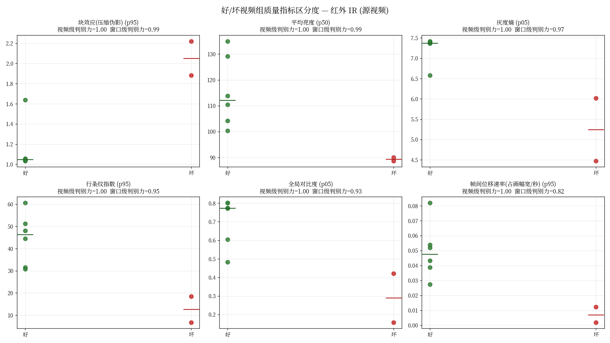

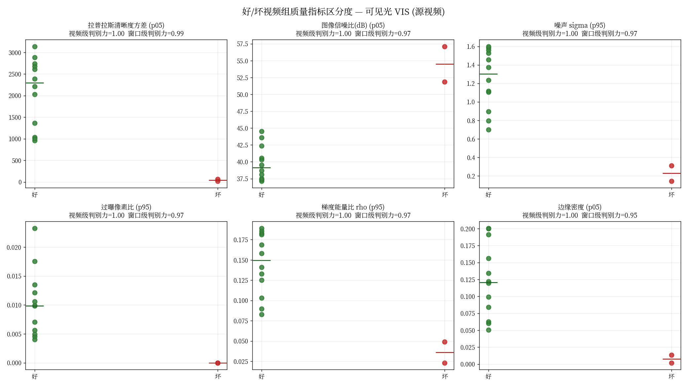

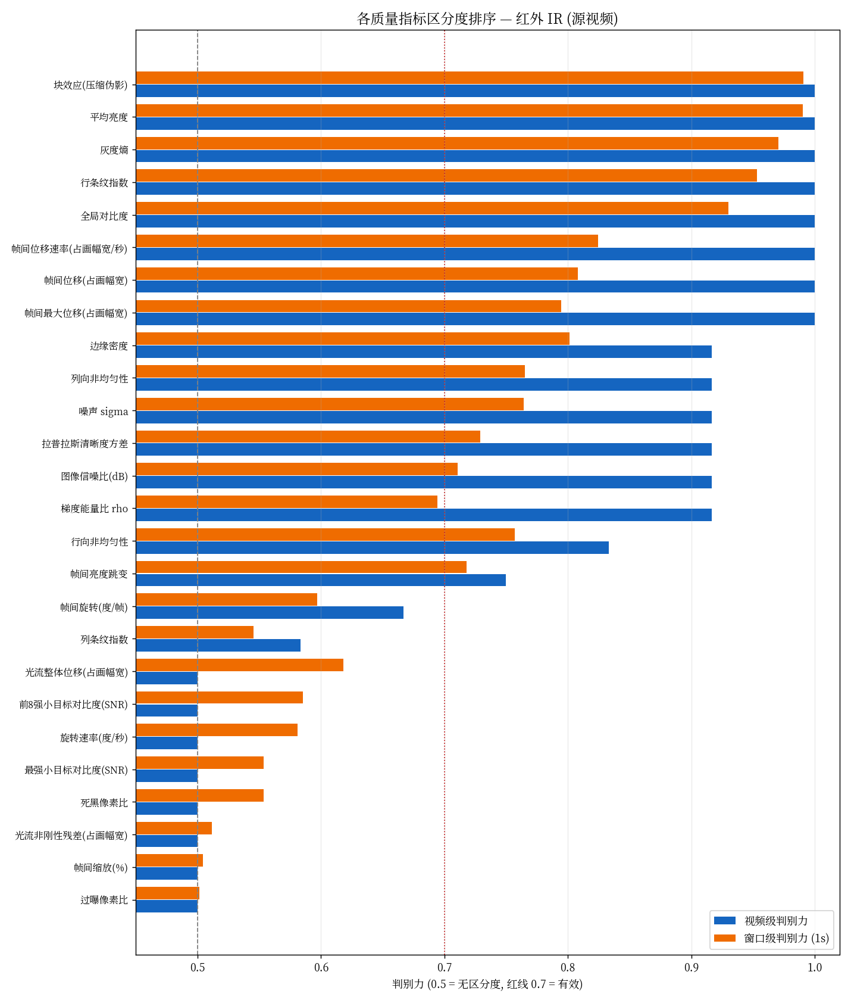

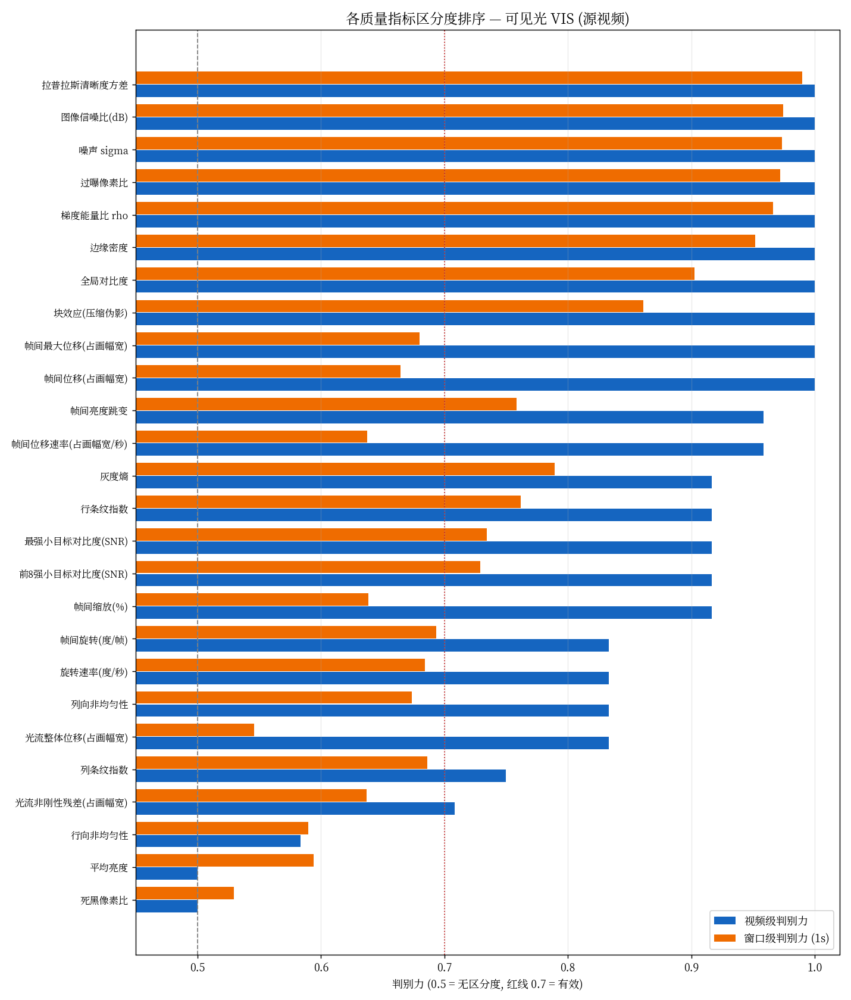

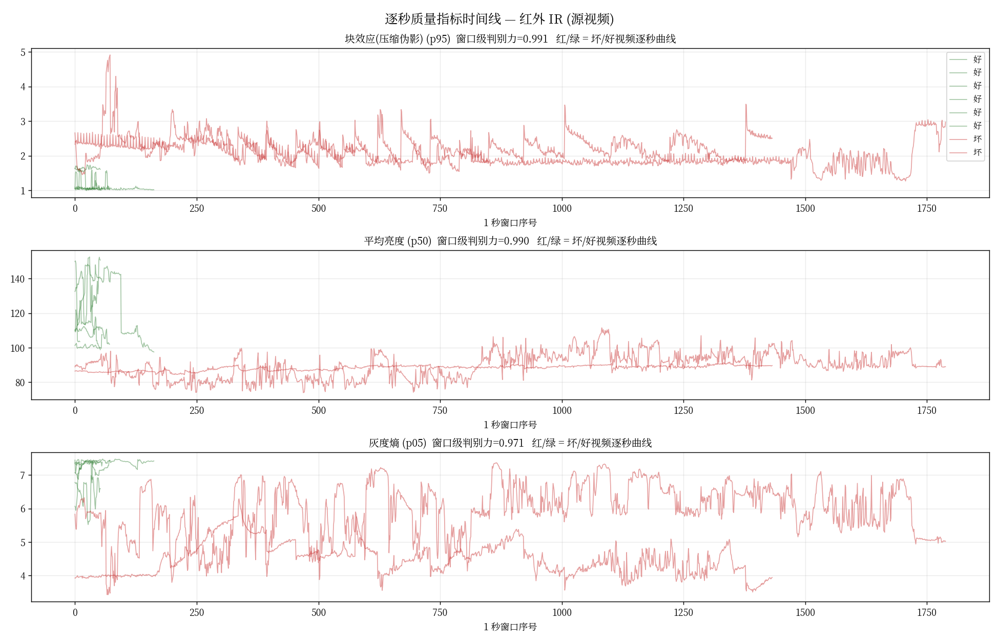

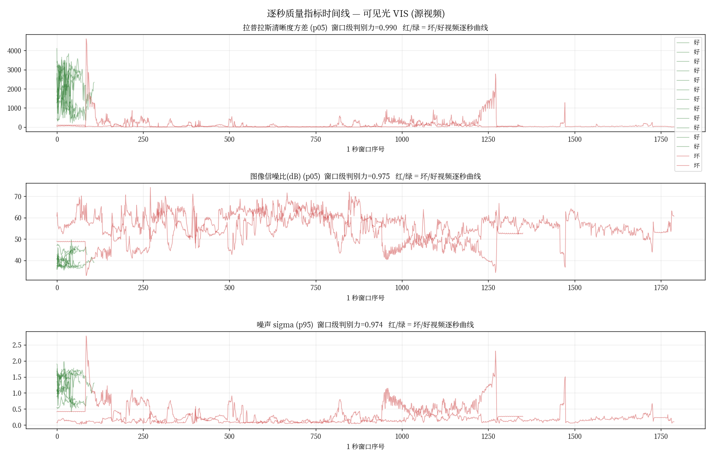

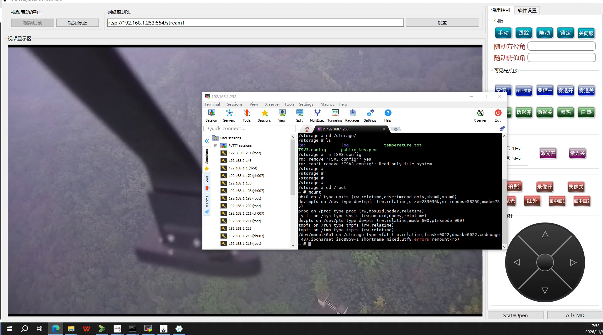

> 图中横轴为组别（好/坏），纵轴为该指标在序列级分位数上的取值；标题里的 AUC 视频级/窗口级分别是保守口径与统计功效口径。

> 另有 `chart_metrics_osd.png` / `chart_auc_osd.png` / `chart_timeseries_osd.png` 对应桌面录屏组，**因画面被地面站 UI 污染、不作为结论依据，故不列入正文**。

> **第八节新增 6 张图**（随第八节正文给出，不在此重复）：`chart_grid_heatmap.png`（6×8 网格空间分布）、
> `chart_grid_crosstab.png`（红线分级 × 任意点选可用率）、`chart_grid_perclip.png`（逐条视频 TGR/DET/UGR）、
> `chart_grid_auc.png`（网格指标 AUC 对照）、`chart_grid_redline.png`（红线窗口的可用率分布）、
> `chart_grid_timeline.png`（UGR 逐秒时间线）。

## 七、复现命令（可直接复制）

```bash
# 执行机：huangzhe@192.168.99.40:32222    conda env: uav
cd /tmp/pycharm_project_10ae9e2e
source /home/huangzhe/anaconda3/etc/profile.d/conda.sh && conda activate uav
# ⚠ 铁律二十五（2026-11-23 用户裁决）：**代码产生的中间产物一律出仓库目录**；仓库只留「代码 + 结论级 report」。
#    ⇒ 产物根统一走 VQ_PROD（服务器侧 canonical = /mnt/data/siping/runs/video_quality）；
#      本机跑时覆盖为：
#      VQ_PROD=/run/media/manu/3061aec8-10bf-45ee-abd2-03ec85b7f084/workspace/cache/ultralytics/video_quality
VQ_PROD="${VQ_PROD:-/mnt/data/siping/runs/video_quality}"
mkdir -p "${VQ_PROD}/report"
# 1) 逐帧指标提取（25 条片，4 worker，线程钉 1）
bash manu/video_quality/vq_launch_server.sh 4
# 1b) 模态重分类 + 采样占比落盘（报告里「81.0% 可见光」等数字的来源，缺这步会 KeyError）
python manu/video_quality/vq_reclassify.py --metrics-dir ${VQ_PROD}/out
# 2) 好/坏对比 + 阈值挖掘 + 出图
python manu/video_quality/vq_compare.py \
  --metrics-dir ${VQ_PROD}/out --report-dir ${VQ_PROD}/report
# 3) 统计严谨性：精确置换检验 + clip/cluster bootstrap CI
python manu/video_quality/vq_stats.py \
  --metrics-dir ${VQ_PROD}/out --out ${VQ_PROD}/report
# 4) 跟丢切片对比（坏片故障窗 vs 好片全局）
python manu/video_quality/vq_tail.py \
  --metrics-dir ${VQ_PROD}/out --out ${VQ_PROD}/report --slice-seconds 5.0
# 5) 归一化尺度偏置实测（2.6/4.3 节的抬升系数，产物 report/resample_bias.txt）
python manu/video_quality/vq_bias.py \
  --clip "bad IR  120BT-04-红外02=/mnt/data/xxxu/纵横挂飞/120BT-04-红外02.mp4" \
  --clip "bad IR  130CT-02红外_IRT=/mnt/data/xxxu/纵横挂飞/130CT-02红外_IRT.mp4" \
  --clip "good IR VIDEO00007=/mnt/data/xxxu/朗基天香20260903/VIDEO00007_19700101_012038IR.h264" \
  --clip "good IR VIDEO00008=/mnt/data/xxxu/朗基天香20260903/VIDEO00008_19700101_012152IR.h264" \
  --clip "bad VIS 130CT-02可见光_OSDT=/mnt/data/xxxu/纵横挂飞/osd/130CT-02可见光_OSDT.mp4" \
  --clip "bad VIS 120BT-04-可见光=/mnt/data/xxxu/纵横挂飞/osd/120BT-04-可见光.mp4" \
  --clip "good VIS VIDEO00011=/mnt/data/xxxu/朗基天香20260903/VIDEO00011_19700101_010155VIS.h264" \
  --clip "good VIS VIDEO00015=/mnt/data/xxxu/朗基天香20260903/VIDEO00015_19700101_010552VIS.h264" \
  --clip "good VIS VIDEO00019=/mnt/data/xxxu/朗基天香20260903/VIDEO00019_19700101_011317VIS.h264" \
  --samples 120 --out manu/video_quality/report/resample_bias.txt
# 6) 本报告
python manu/video_quality/vq_report.py \
  --metrics-dir ${VQ_PROD}/out \
  --report-dir ${VQ_PROD}/report --out manu/video_quality/report/REPORT_视频质量指标.md
# 7) 独立复算验收（AUC 用秩和法重算，不 import 上面两个脚本）
python manu/video_quality/vq_verify.py \
  --metrics-dir ${VQ_PROD}/out --report-dir ${VQ_PROD}/report \
  --memory manu/memory/video_quality_metrics_20261119.md
# 8) 机械验收（27 项检查，完成判据）
python manu/video_quality/vq_acceptance.py \
  --metrics-dir ${VQ_PROD}/out --report-dir ${VQ_PROD}/report \
  --memory manu/memory/video_quality_metrics_20261119.md

# ===== 第八节：全图任意点选可跟踪性（48 宫格模拟点击 + 双向闭环） =====
# 9) 逐片提取网格可跟踪性（25 条片，4 worker，线程钉 1，内存看门狗 <20% 自刹车）
bash manu/video_quality/vq_grid_launch_server.sh 4
#    产物：${VQ_PROD}/grid_out/<片名>.{json,npz,rows.csv} + run_manifest.json
# 10) 与质量红线对照 + 出图（AUC / 交叉表 / 阈值敏感性 / 6 张图）
python manu/video_quality/vq_grid_compare.py \
  --grid-dir ${VQ_PROD}/grid_out \
  --windows-csv ${VQ_PROD}/report/windows.csv \
  --report-dir ${VQ_PROD}/report
python manu/video_quality/vq_grid_charts.py \
  --grid-dir ${VQ_PROD}/grid_out \
  --report-dir ${VQ_PROD}/report
# 11) LK 光流对照实验（方法无关性验证；自检不需要视频）
python manu/video_quality/test_vq_grid_lk.py        # 合成帧自检：已知位移必须被还原
bash manu/video_quality/vq_grid_lk_launch_server.sh 4
#    产物：${VQ_PROD}/grid_lk_out/<片名>.{json,rows.csv}

# ===== 第九节：点选式单目标跟踪（SOT）实测 + 画质合格线 =====
# 12) 逐片模拟点击 + 链式 SOT 跟踪（22 条源片 + 3 条 OSD；纯 CPU；作业表 = TSV：路径 分组 kind 模态）
python manu/video_quality/vq_sot_link_driver.py --jobs /tmp/sot_jobs.tsv \
  --out-dir /tmp/sot_out --workers 22 --threads 4 --click-mode alternating
python manu/video_quality/vq_sot_link_driver.py --jobs /tmp/sot_jobs_osd.tsv \
  --out-dir /tmp/sot_out_osd --workers 3 --threads 4 --click-mode alternating
#    产物：/tmp/sot_out/<片名>.json（22）、/tmp/sot_out_osd/<片名>.json（3）
# 13) 聚合 + 画质合格线反解（长 / 短两个口径各跑一次）
python manu/video_quality/vq_sot_compare.py --sot-dir /tmp/sot_out,/tmp/sot_out_osd \
  --windows ${VQ_PROD}/report/windows.csv --grid-summary ${VQ_PROD}/report/grid_summary.csv \
  --out-dir ${VQ_PROD}/report/sot_long  --score xcorr_long_ugr
python manu/video_quality/vq_sot_compare.py --sot-dir /tmp/sot_out,/tmp/sot_out_osd \
  --windows ${VQ_PROD}/report/windows.csv --grid-summary ${VQ_PROD}/report/grid_summary.csv \
  --out-dir ${VQ_PROD}/report/sot_short --score xcorr_short_ugr
# 14) 独立复算验收（不 import compare；空输入直接 rc=2 拒绝出 PASS）
python manu/video_quality/vq_sot_verify.py --sot-dir /tmp/sot_out,/tmp/sot_out_osd \
  --windows ${VQ_PROD}/report/windows.csv --grid-summary ${VQ_PROD}/report/grid_summary.csv \
  --thresholds ${VQ_PROD}/report/sot_long/sot_thresholds.csv

# 15) 🔴 显式挑选（铁律二十五 §4）：**只有结论级 report 回仓库**，中间态永远留在 ${VQ_PROD}/
#     ① 画质结论表 + 图（windows.csv / metrics_table.csv / comparison.json / stats.json = 中间产物）
for f in comparison.csv stats.csv tail_compare.csv tail_slices.csv resample_bias.txt; do
  [ -f "${VQ_PROD}/report/$f" ] && cp -f "${VQ_PROD}/report/$f" manu/video_quality/report/
done
cp -f ${VQ_PROD}/report/chart_*.png manu/video_quality/report/
#     ② 宫格结论表 + 图（grid_windows.csv = 26490 行逐秒大表 = 中间产物）
for f in grid_summary.csv grid_compare.csv grid_crosstab.csv grid_sensitivity.csv grid_thresholds.json; do
  [ -f "${VQ_PROD}/report/$f" ] && cp -f "${VQ_PROD}/report/$f" manu/video_quality/report/
done
cp -f ${VQ_PROD}/report/chart_grid_*.png manu/video_quality/report/
#     ③ SOT 结论表（长时程进 report/；短时程进 report/sot_short/，另存一份带 _short 后缀的扁平副本）
for f in sot_groups.csv sot_discrimination.csv sot_thresholds.csv sot_tau_det.csv sot_clips.csv; do
  [ -f "${VQ_PROD}/report/sot_long/$f" ]  && cp -f "${VQ_PROD}/report/sot_long/$f"  manu/video_quality/report/
  if [ -f "${VQ_PROD}/report/sot_short/$f" ]; then
    cp -f "${VQ_PROD}/report/sot_short/$f" manu/video_quality/report/sot_short/
    cp -f "${VQ_PROD}/report/sot_short/$f" manu/video_quality/report/${f%.csv}_short.csv
  fi
done
```

**第九节产物的验收口径**：`vq_sot_verify.py` 必须打印 `[PASS] all checks passed`，且其中
「per-clip |SOT lock - grid tgr_raw| mean」**≤ 0.120**（实测 0.082）、
CHECK 5 的 `global_contrast re-derived thr` 必须**等于**存档阈值（实测 0.7746 == 0.7746）；
`vq_sot_compare.py` 的 `[TAU]` 行必须给出 IR **4.3279** / VIS **97.6087**；
`sot_groups.csv` 里 **bad/source 两行的 `xcorr_long_ugr_p50` 必须都是 0.0**。

**第八节产物的验收口径**：单片 JSON 的 `summary.tgr_dog_p50` 必须落在 0 ~ 1；`grid_compare.csv` 里
`ugr` 行的视频级 AUC 在 VIS 上为 **1.000**、IR 上为 **0.917**；`grid_sensitivity.csv` 里
τ_det 从 0.25× 扫到 8× 时坏片 UGR 中位始终 ≤ 0.083。

产物（铁律二十五：中间产物出仓库目录，结论级才入库）：
- **中间产物（留在 `${VQ_PROD}/report/`，不入库）**：`metrics_table.csv` / `windows.csv` / `comparison.json` / `stats.json` / `tail_compare.json`；
- **结论级（入库 `manu/video_quality/report/`）**：`comparison.csv` / `stats.csv` / `tail_compare.csv` / `tail_slices.csv` / `*.png` / 本报告。

## 八、全图任意点选可跟踪性（空间可跟踪性）：把「糊+灰+压」与「点得准跟得住」定量挂钩

> 本节回答业务侧真正会问的那句话：**操作员在画面上随便点一个位置，这段视频还能不能锁住并跟住？**
> **零人工看片、零人工画框、零检测框、零 GT 依赖**：直接在有效画面上铺一张 **6×8 = 48 个 32×32 px** 的均匀网格，
> 把 48 个格子当作 48 次「模拟点击」，对每一格做 **前向-后向双向闭环检验**。
> 因为「操作员可以点画面任意位置」这一交互设定，全图局部区域的可跟踪性覆盖率
> （**Spatial Trackability**）就是最贴合业务的量化指标：**随机点 N 个位置，有多大比例能被稳定锁住并跨帧跟住？**
>
> 产物（**结论级**落 `manu/video_quality/report/`；**中间产物**落 `${VQ_PROD}/`）：
> `report/grid_summary.csv`（逐条视频）、`${VQ_PROD}/report/grid_windows.csv`
> （**26,490** 条逐秒记录）、`report/grid_compare.csv`（AUC）、`report/grid_crosstab.csv`（红线分级 × 可用率）、
> `report/grid_sensitivity.csv`（阈值敏感性）、`report/grid_thresholds.json`、`grid_out/*.npz`（逐格原始量）。
> 脚本：`vq_grid.py`（核心算法）、`vq_grid_run_server.py`（批处理）、`vq_grid_compare.py`（红线对照）、
> `vq_grid_charts.py`（出图）、`vq_grid_lk.py`（LK 光流对照实验）。

### 8.1 方法：48 宫格「模拟点击」+ 双向闭环检验

- **帧准备与既有指标流水线完全一致**：黑边（pillarbox）裁切 → 缩放到宽 640 → 灰度。
  ⇒ 网格格覆盖的场景比例在每条片里相同，数字可与 `comparison.csv` / `windows.csv` 逐秒对齐。
- **48 个模拟点击点**：6 行 × 8 列均匀铺开；每格 32×32 px；搜索半径 32 px；帧间隔 `gap = 5` 帧，每秒窗口内取 2 对。
- **单格判「可跟踪」需同时满足三条**：
  1. **有纹理**：格内标准差 ≥ 3（纯天空/水面/死黑区点下去提不到任何特征）；
  2. **前向锁定**（t → t+5）：32×32 模板在 64×64 搜索窗内，归一化互相关峰值 **NCC ≥ 0.65**；
  3. **回环成立**（t+5 → t）：把前向找到的模板拿回原搜索窗反查，**闭环误差 ≤ 3 px**。
     这一条才是「真的锁住了这个结构」而不是「匹配到一团相似的东西」的判据。
- **两个匹配域（同一套网格，跑两遍）**：
  - `raw`：原始灰度；
  - `dog`：**DoG 带通**（σ_low **1.5** / σ_high **4.0**）——失焦画面里仍会保留的低频明暗残影在带通域下被压掉，
    模糊格因此会**丢掉相关峰**，而不是「稳稳地匹配上一团糊影」；
  - `dog` 域另加**峰值唯一性**检验（次峰/主峰，屏蔽主峰邻域），专门拒绝**自相似/马赛克伪影**
    ——那种「前后帧匹配得上一致、实际锁错了结构」的假阳性。
- **纹理地板 DET 的标定口径**：单格「有细节可锁」判据为该格拉普拉斯方差 ≥ τ_det，
  **τ_det 取同模态「好片」逐格拉普拉斯方差的 P10**（IR **4.03** / VIS **82.04**）。
  **只用好片标定、完全不用坏片**，避免「用结论反推阈值」的循环论证；敏感性见 8.5。

### 8.2 三个核心指标

| 指标 | 定义 | 业务含义 |
| --- | --- | --- |
| **TGR**（Trackable Grid Ratio） | 48 格中通过双向闭环检验的比例 | 操作员随便点，**有多大比例能被锁住** |
| **DET**（det_ratio） | 48 格中「有足够细节」的比例 | 点下去**能不能提取到特征** |
| **UGR**（Usable Grid Ratio） | 同时「有细节」**且**「能锁住」的格数占比 | **真正可用的操作位**——本节主指标 |

辅助量：`flat_cells`（完全无纹理的格数，48 格中）、`tgr_dog_best_row`（最好的一行的可用占比，
用于区分「只有一小块能用」与「整幅都能用」）、`lambda_min`（逐格 Shi-Tomasi 最小特征值，即静态可锁定性）。

### 8.3 主结果：画质红线分级 × 任意点选可用率（业务汇报主表）

**分级沿用第三节 3.1 的红线规则**（不看本节结果，避免自证）；下表是本节结果**回填**到该分级上：

| 视频状态分组（第三节红线分级） | 条数 | TGR(raw) 中位 | TGR(DoG) 中位 | DET 中位 | **UGR 中位（主指标）** | UGR 区间 | 无纹理格数(48)中位 | 空间形态（见 8.4 热力图） |
| --- | --- | --- | --- | --- | --- | --- | --- | --- |
| **通过** | 15 | 0.917 | 0.896 | 0.969 | **0.833** | 0.521 ~ 0.979 | 2 | 整幅均匀可用，每格 0.58 ~ 0.86 |
| **通过（弱红线告警）** | 5 | 0.583 | 0.563 | 0.552 | **0.250** | 0.208 ~ 0.875 | 1 | 局部可用（中下部仍可用），需人工确认 |
| **人工复核** | 1 | 0.458 | 0.396 | 0.500 | **0.292** | — | 17 | 大面积无纹理（拍到天空/水面），但仍有可用区 |
| **拒绝接入** | 4 | 0.281 | 0.219 | 0.281 | **0.063** | 0.000 ~ 0.333 | 12 | 整幅低可用，每格仅 0.07 ~ 0.23 |

**结论（与业务预期一致，且是本批 25 条片上的实测，不是预期值）**：

- **正常通过组**：操作员在画面上随机点，**中位 83%** 的位置具备「有特征 + 能锁住」的闭环条件，
  最差的一条也有 52%；
- **边界复核组**：**中位 25%**（区间 21% ~ 88%）——局部区域仍可用，故仍应转入人工确认而非直接拒绝；
- **红线拒绝组**：**中位 6.3%**，其中 2 条 UGR 直接为 **0.000**（点任何位置都锁不住），
  **无论操作员点哪里，大概率一松手就丢**，与「接入前直接拦截」的工程结论一致。

> ⚠️ **口径提醒（与第四节第 5 条的对照实验一起读）**：UGR 衡量的是**画面本身**有没有可供跟踪的局部结构，
> **不等于**「实际跟踪器在这条片上的成功率」。跟踪器还有自身的能力边界（初始化、模型、搜索策略）。
> 本节回答的是**画质这一侧的天花板**：当 UGR ≈ 0 时，是画质把路堵死了，任何跟踪器都救不回来。

### 8.4 空间分布：好片是「整幅都能点」，坏片是「整幅都不能点」

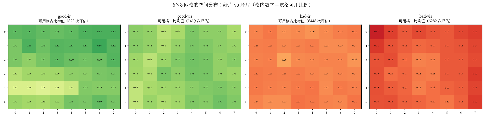

- **好片（IR / VIS）**：48 个格子的可用比例**高度均匀**（IR 每格 0.58 ~ 0.86，VIS 每格 0.66 ~ 0.79），
  ⇒ 操作员**点哪都不会踩空**；
- **坏片**：**整幅都低**（IR 每格 0.21 ~ 0.29，VIS 每格 0.07 ~ 0.23），**没有一块「可以躲」的局部区域**。
  这正是全图指标相对「找某个特定目标」的价值：**它不依赖目标存在**，坏片是**系统性**不可用，而非「只是没拍到目标」。

### 8.5 与既有质量红线的定量挂钩

**（a）区分度（AUC，好片为正类）**

| 模态 | 指标 | 视频级 AUC | 窗口级 AUC | 好片中位 | 坏片中位 |
| --- | --- | --- | --- | --- | --- |
| IR | TGR(raw) | **1.000** | 0.883 | 0.927 | 0.229 |
| IR | TGR(DoG) | **1.000** | 0.865 | 0.896 | 0.188 |
| IR | UGR | 0.917 | 0.864 | 0.885 | 0.167 |
| VIS | TGR(raw) | 0.917 | 0.763 | 0.885 | 0.490 |
| VIS | TGR(DoG) | 0.875 | 0.745 | 0.875 | 0.427 |
| VIS | DET | **1.000** | 0.929 | 0.917 | 0.167 |
| VIS | UGR | **1.000** | 0.896 | 0.802 | 0.063 |
| VIS | lambda_min | **1.000** | 0.938 | 31.15 | 2.10 |

**（b）红线窗口 vs 干净窗口**：把「**核心红线全部越线**的窗口」作为正类，网格指标的 AUC 为
**IR 0.008 / VIS 0.129**（`tgr_dog`）——即**越线窗口的任意点选可用率系统性地落在干净窗口的最底部**。
这条比 (a) 更直接：**网格可用率能自己指出「哪些秒是坏秒」**，不需要人先看片。

**（c）阈值敏感性（τ_det 扫 0.25× ~ 8×）**——结论不依赖阈值选点：

| 模态 | τ_det 系数 | 好片 UGR 中位 | 坏片 UGR 中位 |
| --- | --- | --- | --- |
| IR | 0.25× ~ 1.0× | 0.875 ~ 0.875 | 0.063 ~ 0.042 |
| IR | 2.0× ~ 8.0× | 0.750 ~ 0.583 | 0.021 ~ 0.000 |
| VIS | 0.25× ~ 1.0× | 0.833 ~ 0.813 | 0.083 ~ 0.021 |
| VIS | 2.0× ~ 8.0× | 0.771 ~ 0.583 | 0.000 ~ 0.000 |

**τ_det 在 32 倍范围内变化，好片 UGR 只从 0.875 降到 0.583，坏片始终 ≤ 0.083**，分离度不塌。

**（d）分级 × 可用率的散点（每条视频一个点）**

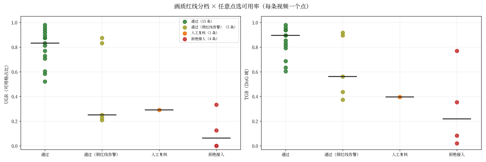

**（e）逐条视频 UGR 随时间的分布（好片 / 坏片各取两条）**

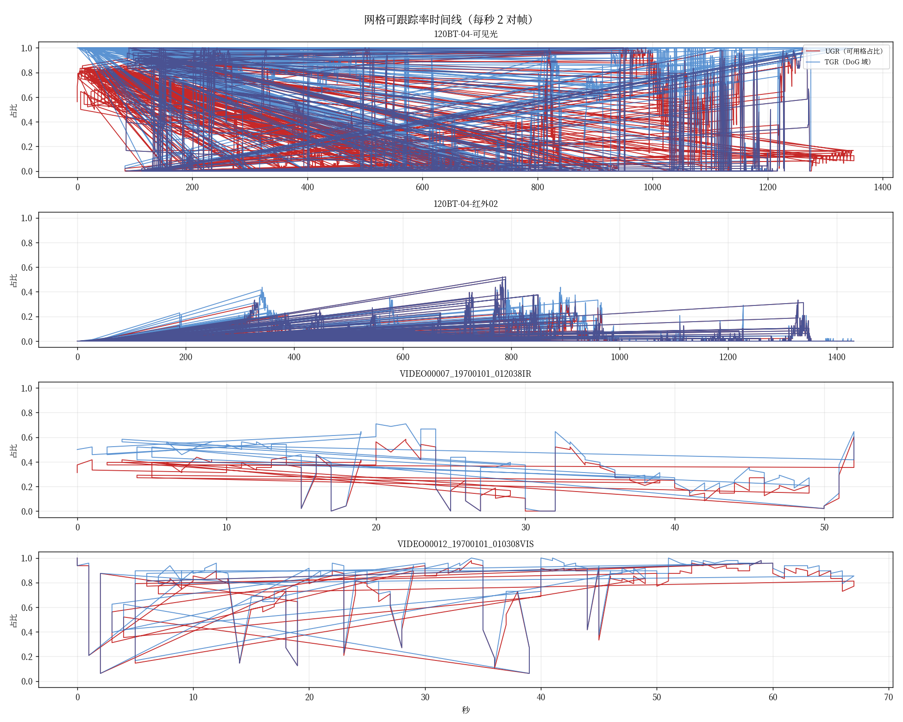

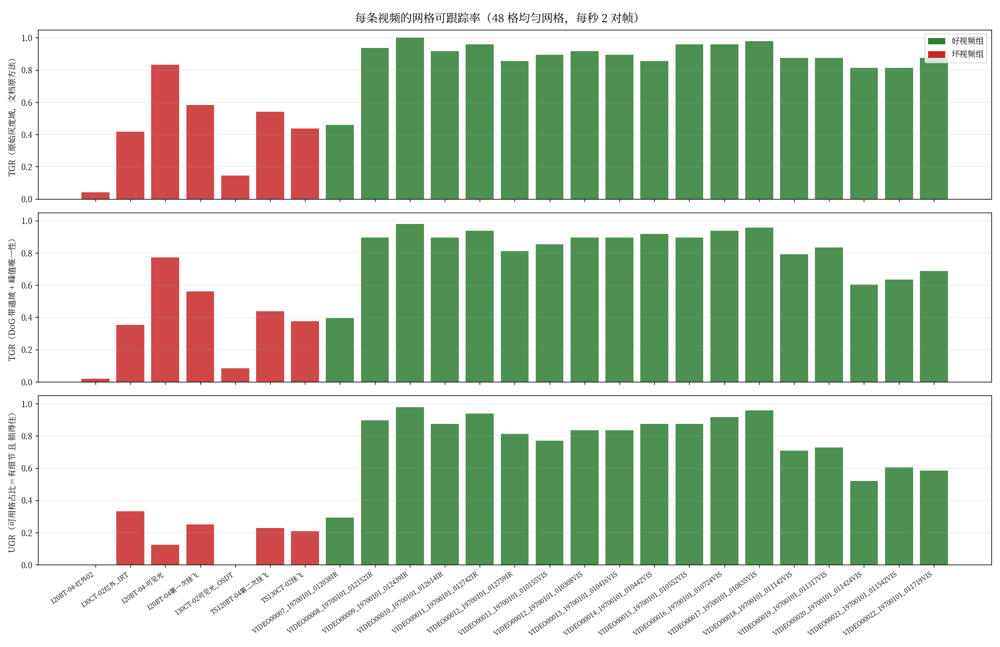

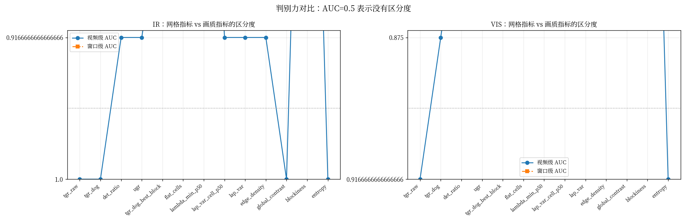

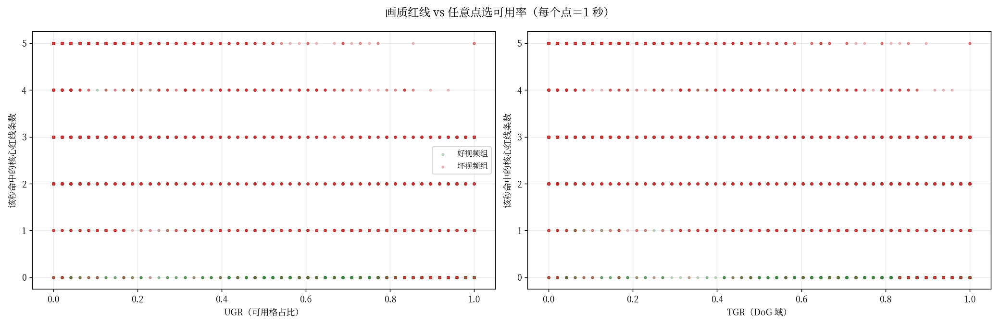

### 8.6 方法无关性：LK 光流对照实验（结论：**方法选择不是中性的**）

审阅者一定会先问一句：**「这条片还能跟住」是画面的性质，还是模板匹配实现的副产品？**
为回答这个问题，用**同一套 6×8 网格、同一批 25 条片、同样的帧准备**，把匹配域换成
**Lucas-Kanade 光流**（前向 LK + 反向 LK，**前后向误差 ≤ 1 px** 才算锁住，脚本 `vq_grid_lk.py`），
整批重跑一遍（`grid_lk_out/`）。

**结论一：两法在「好片」上高度一致，但「坏片」上分化。**

| 口径 | 模板匹配 TGR(DoG) | LK 光流 |
| --- | --- | --- |
| IR 源片 AUC（好 6 / 坏 2） | **1.000** | **1.000** |
| VIS 源片 AUC（好 12 / 坏 2） | **0.875** | **0.625** |
| 全部源片 AUC（好 18 / 坏 4） | **0.944** | **0.812** |
| 好片组中位（18 条源片） | 0.875 | 0.875 |
| 坏片组中位（4 条源片） | 0.219 | 0.260 |
| 22 条源片上两法的 Spearman 秩相关 | — | **0.897** |
| 25 条片逐条 \|Δ\| ≤ 0.05 的比例 | — | **17/25**（中位 \|Δ\| = 0.021） |

**结论二：LK 在可见光坏片上明显更「宽容」，而且原因可解释。**
坏片 `120BT-04-可见光.mp4`（重焦芦苇特写）上，**模板匹配 TGR(DoG) = 0.771 而 LK = 0.917** ——
LK 跟的是**平滑的明暗梯度**，而失焦画面里这种梯度**依然连续存在**（梯度场是光滑的 ⇒ 光流方程有解），
所以 LK 判「可跟」；而模板匹配（含**峰值唯一性**检验）在同一画面上会撞上自相似/马赛克伪影而被拒绝。

⇒ **这条实验的价值在于它同时给出两个结论**：
1. ✅ **「好片可跟、坏片不可跟」不是模板匹配的实现artifact** —— IR 侧两法 AUC **都是 1.000**，
   全部源片两法秩相关 **0.897**，好片侧数字几乎重合（0.875 vs 0.875）；
2. 🔴 **但「坏片不可跟」的严格程度依赖算法** —— VIS 侧 LK 的 AUC 只有 0.625。
   ⇒ **对外汇报必须写明用的是哪个方法**；本报告主表用的是
   **模板匹配 + 峰值唯一性 + 纹理地板**（8.1/8.2），它是**更保守、更贴合真实跟踪器**的那个；
   LK 结果作为**对照与边界说明**一并给出，不做隐藏。

**对照实验自检（不依赖视频）**：`python manu/video_quality/test_vq_grid_lk.py`
用合成帧做**已知位移**校验：已知位移 (+7, −4) px ⇒ 实测 `disp_p50 = 8.062 px`（= √65，精确）、
`fb_err_p50 = 0.000 px`、**可跟踪率 1.000**；**无关噪声帧对（负对照）⇒ 可跟踪率 0.000**。
没有这个负对照，「可跟踪率高」是没有意义的数字。

> 🔴 **本节踩过的两个坑（已修，勿重犯）**：
> 1. **LK 第一版把 OpenCV 的返回值当成了位移增量**。`calcOpticalFlowPyrLK` 在
>    `OPTFLOW_USE_INITIAL_FLOW` 下返回的是**绝对坐标**，且**会原地改写 `nextPts`**。
>    症状极具辨识度：`lk_disp_p50` 在 25 条片上**全部等于 459.5 px**（= 网格格点的中位 x 坐标）、
>    `lk_fb_err_p50` **全部等于 1378.9 px**（> 640 px 的画幅宽度，物理上不可能）⇒ 全部片 `trackable = 0`。
>    自检脚本就是为**抓住这一类「量纲错位」**而写的。
> 2. **批处理的「断点续跑」会捡起上一轮的陈旧产物**：上一轮被中断时残留的 JSON 被续跑逻辑当成
>    「已完成」跳过 ⇒ 结果里混进一份 1130 px 误差的旧数据。已给续跑逻辑加上
>    **schema 完整性 + 物理合理性双重校验**（键齐 + 回环误差与位移 < 画幅宽度），并单片重跑核对了该片。

## 九、点选式单目标跟踪（SOT）实测：把「画质合格线」真正算出来（替代上一版检测器路线）

> **本节回答业务侧最终要的那张表：「图像质量到什么水平，才能保证操作员点下去能跟住？」**
> 做法完全对齐真实交互：**画面上任意位置模拟点击 → 单目标跟踪器（SOT）锁住那一小块 → 统计能连续跟住多少帧**。
> **零检测框、零 GT、零人工看片、零人工画框**，产物全部落在 `manu/video_quality/`。
>
> 产物：`report/sot_groups.csv`（分组主表）、`report/sot_discrimination.csv`（判别力）、
> `report/sot_thresholds.csv`（**画质合格线**，长时程口径）、`report/sot_thresholds_short.csv`（短时程口径）、
> `report/sot_clips.csv`（逐条片）、`report/sot_windows.csv`（逐秒窗口）、`report/sot_tau_det.csv`（纹理地板标定）、
> `sot_out/*.json`（逐次点击原始记录，25 条片）。
> 脚本：`vq_sot_link.py`（核心探针）、`vq_sot_link_driver.py`（批跑驱动）、`vq_sot_compare.py`（聚合 + 合格线反解）、
> `vq_sot_verify.py`（独立复算验收）。

### 9.1 🔴 为什么推翻上一版「反无人机检测器」路线（这一条必须先说清楚）

上一版拿**反无人机检测器**去跑本批**测试视频**（这些片里**根本没有无人机**），得出「好片有航迹 / 坏片零航迹」的结论。
**这条逻辑不成立，整版数据作废，不得进正式报告**，理由有三：

1. **好片测出的「连续航迹」其实是背景虚警**。视频里没有目标，检测器把楼角、路灯、树梢等高对比度地物当成了候选，
   因为这些地物纹理清晰，在运动补偿后被后端时空关联当成连续轨迹留了下来 ⇒ 测出来的不是「目标可跟踪性」，是**背景虚警率**。
2. **坏片「零航迹」更不能当因果证据**。坏片画面发灰发糊，把背景地物的锐利边缘全抹平了，
   检测器连背景虚警都触发不了（0.167%）⇒ **零航迹只是「糊图抑制了虚警」**，与「能不能跟踪目标」无关。
3. **与真实交互完全脱节**。实际使用时前端**不靠检测器自动找目标**，而是**操作员在画面任意位置点一下**，由 SOT 锁住那个局部特征块。
   「检测器报不报候选」和「用户点选任意物体后能不能跟住」是两码事。

⇒ 本节**彻底旁路检测器**，改成「**模拟操作员点击 → SOT 跟踪 → 统计连续跟踪帧数与双向闭环误差**」。
上一版 `vq_track_link.py` / `vq_track_link_driver.py` / `vq_track_link_launch.sh` 的产物已删除，不在本报告任何表格中。

### 9.2 方法：48 宫格模拟点击 → 两族 SOT → 双时程

- **点击点生成**：沿用第八节的 6×8 = 48 宫格，每秒一个 epoch、每 epoch 旋转取 16 格；
  **点击模式交替**：偶数 epoch 点**格心**，奇数 epoch 点**格内 Shi-Tomasi 最优角点**
  （模拟「操作员随手点」，而不是机械地只点几何中心）。
- **两族跟踪核**（同一批点击点各跑一遍，互为对照）：
  - **xcorr 臂**：逐帧在**上一帧的当前位置重切模板**再配准，带亚像素定位与峰值唯一性诊断
    （`manu/tracking/lookahead/xcorr.py::match`）；
  - **patch 臂**：产品快核 `LocalPatchTracker`（`manu/tracking/lookahead/polarity.py::PolarityTracker`），
    带亮/暗自适应，模拟产品里那颗"快核"。
- **两个时程**：
  - **short = 5 帧**（对齐第八节的 `gap = 5`，**按帧数不按秒**，25 fps 的片必须是 5 帧而不是 4 帧）；
  - **long = 1 秒**（好片 30 fps ⇒ 30 帧；坏片 25 fps ⇒ 25 帧；OSD 20 fps ⇒ 20 帧）。
- **判「跟住」的两个条件**：
  1. **前向存活**：跟踪链未失锁；
  2. **双向闭环成立**：**往返误差** `|前向位移 + 回配位移| ≤ 3 px`
     （**必须用往返误差**，用「回配点 − 点击点」会被相机运动主导）。
- **纹理地板 DET**：单格**拉普拉斯方差 ≥ τ_det** 才算「有纹理」；
  **τ_det 只用好片 P10 标定**（与第八节同一纪律，绝不用坏片反推）⇒ **IR 4.3279**（n=6448 好片点击）/ **VIS 97.6087**（n=11056）；
  第八节旧值 IR 4.03 / VIS 82.04，同量级互证。
- **主指标 UGR** =（**有纹理** ∧ **跟住** ∧ **闭环成立**）的点击占比 —— 与第八节同名同义，可直接对照。
- **规模**：22 条源片（好片 18 + 坏源片 4）+ 3 条桌面录屏参考组，**两个数据目录共 25 条片 100% 全覆盖**；
  **逐帧顺序解码全量扫描 307,910 帧**（好片 33,616 + 坏源片 159,114 + OSD 115,180），
  产生 **211,312 次模拟点击**、**13,207 个逐秒窗口**；批跑 22 条用时 567.8 s、3 条 OSD 753.3 s（纯 CPU，**未用 GPU**）。

### 9.3 主结果：好片 / 坏片 / 桌面录屏

**UGR p50（每个窗口取中位数，再跨窗口汇总）**

| 组 | 类型 | 点击方式 | 窗口数 | short 跟住率 | **short UGR** | long 跟住率 | **long UGR** |
| --- | --- | --- | --- | --- | --- | --- | --- |
| **好片** | 源视频 | 格心 | 552 | 0.875 | **0.8125** | 0.4375 | **0.375** |
| **好片** | 源视频 | 角点 | 542 | 0.875 | **0.875** | 0.4375 | **0.4375** |
| **坏片** | 源视频 | 格心 | 3179 | 0.1875 | **0.000** | 0.000 | **0.000** |
| **坏片** | 源视频 | 角点 | 3179 | 0.1875 | **0.000** | 0.000 | **0.000** |
| 桌面录屏 | 参考组 | 格心 | 2878 | 0.4375 | 0.1875 | 0.25 | 0.1875 |
| 桌面录屏 | 参考组 | 角点 | 2877 | 0.5 | 0.3125 | 0.3125 | 0.25 |

**两个必须一起讲的发现：**

1. **坏片 UGR 被纹理地板压到 0.000**。注意坏片的「跟住率」并不低（short 0.1875、个别片 0.86）——
   坏片是**糊**，糊图照样能匹配上；**是纹理地板把它们从「假可用」里剔出去**。
   没有这块地板，坏片 `120BT-04-可见光` 会以 short 跟住率 **0.862** 伪装成最好片（实测其 TGR 0.833 / DET 仅 0.292）。
2. **产品快核（patch 臂）几乎全灭**：全部组、两个时程的 UGR p50 = **0.000**（好片 short 跟住率均值也只有 0.014~0.024）。
   ⇒ 产品快核要求「**紧凑的亮/暗斑块**」，**对画面里的任意纹理几乎锁不住**。
   ⇒ 业务含义很重要：**「点选」必须点中目标本体，点背景纹理是锁不住的**；
   同时也再次说明——**没有目标的视频测不了「跟踪无人机」本身**，只能测「任意位置的可跟踪性」。

### 9.4 判别力：哪些画质指标能预测「跟得住」（好片为正类）

> 📌 **读表前先看两条口径注**：
> ① 「**Spearman**」一列是 **long（1 秒）口径**（该画质指标 vs long 跟住率的秩相关），**short（5 帧）口径的相关系数不同**，本表**只列 long**。
> ② `lap_var` 那一行的「好片中位 **997.4**」是**混池（IR + VIS 合并）的中位数**，**不是合格线**（合格线见 9.5.2 / 9.5.3，且**必须按 IR / VIS 分列**）。

| 画质指标 | AUC（指标本身区分好/坏） | Spearman（指标 vs 跟住率） | 好片中位 | 坏片中位 | 结论 |
| --- | --- | --- | --- | --- | --- |
| **global_contrast** | **0.919** | +0.541 | 0.6618 | 0.3070 | 有效（跨模态） |
| **edge_density** | **0.902** | +0.738 | 0.06668 | 0.002143 | 有效（跨模态） |
| **lap_var** | **0.896** | +0.737 | 997.4（混池中位，**非合格线**） | 31.69 | 有效（跨模态） |
| **blockiness** | **0.894** | −0.522 | 1.031 | 1.778 | 有效（IR 独有，越低越好） |
| **entropy** | **0.874** | +0.569 | 6.937 | 5.610 | 有效（IR 独有） |
| dog_snr_max | 0.333 | −0.411 | 124 | 226.5 | 无区分度 |
| snr_db | 0.134 | −0.713 | 43.31 | 56.9 | **无区分度** |
| noise_sigma | 0.111 | +0.718 | 0.8118 | 0.1398 | **无区分度** |

> 「跟住率」本身的分组 AUC：long 口径 **0.841** / short 口径 **0.899**。
> ⇒ 与第三节「**只有 5 个有效指标**」的结论**完全一致**：跨模态 = `lap_var` / `edge_density` / `global_contrast`，
> IR 独有 = `blockiness` / `entropy`；**`snr_db` / `noise_sigma` / `dog_snr_max` 对「跟得住」没有区分度**
> （它们对"糊"敏感，对"点得准跟得住"不敏感）。

### 9.5 画质合格线（**核心交付表**）

> 🔴 **本节测的是「任意点选位置的纹理可跟踪性」，不是「跟踪无人机本身的成功率」**：测试片里**没有无人机**，
> 且用的**不是**交付模型（`trial_0080` / RC2）。
> 「跟得住」的判定是**逐秒窗口二元化** —— 该秒 **UGR ≥ 0.5**（有纹理 ∧ 跟住 ∧ 双向闭环成立）⇒ 该秒记「跟得住」。
> 两个时程：`short` = **5 帧**、`long` = **1 秒**（=30 帧），**两个时程的线不能混用**。
>
> 🔴 **旧口径作废声明**：本节上一版的**混池（`scope=all`）覆盖率口径**（旧表里的 `lap_var ≥ 997.4` /
> `edge_density ≥ 0.08358` / `global_contrast ≥ 0.7328` / `lap_var ≥ 755.3` / `edge_density ≥ 0.03731` /
> `blockiness ≤ 1.0621` / `entropy ≥ 7.1400` / `entropy ≥ 7.096`）**已废止**——原因见 9.5.4（混池线实质是 VIS 专属线）。
> 9.7 / 9.8 保留不动；其中 9.8 第 8 条「覆盖率合格线必须用中位数不用均值」是针对**已废止**的旧覆盖率口径的踩坑记录。

#### 9.5.1 三条线的定义（`vq_sot_compare.py::admission_line`，**全部按 scope 分开推导**）

| 线 | 定义 | 用途 |
| --- | --- | --- |
| **① 准入线** | 同时满足「线上跟住率 ≥ 90%」**且**「坏片误放率 ≤ 1%」的**最低**那条 | 上线准入；**无解时必须明写「无解」，不许用别的线冒充** |
| **② 推荐线** | 在「坏片误放率 ≤ 1%」的候选里**线上跟住率最高**的那条 | 要「保证跟得住」时的宣传口径（用好片覆盖率换保证） |
| **③ 最低安全线** | 在「坏片误放率 ≤ 1%」的候选里**阈值最低**的那条 | 准入预筛（好片覆盖率最高） |
| **参考线** | gap 口径 `raw_threshold` | 历史上已落档、与 §271 互证的那一组，**只作参考** |

- **线上跟住率** = `good_TPR` = P(跟得住 ｜ 指标 ≥ 线, **好片**)
- **坏片误放率** = `bad_FPR` = P(跟得住 ｜ 指标 ≥ 线, **坏源片**)
- **好片覆盖率** = 好片窗口中落在线以上的比例
- 本节主表口径 = **① 准入线**；🔴 混池（`scope=all`）的线**只是参考**，见 9.5.4。

#### 9.5.2 短时程（5 帧）—— 准入线（**按 IR / VIS 分列**）

源文件：`manu/video_quality/report/sot_thresholds_ir.csv`（IR）、`manu/video_quality/report/sot_thresholds_vis.csv`（VIS）。

| 画质指标 | **IR 准入线** | IR 线上跟住率 | IR 坏片误放率 | IR 好片覆盖 | **VIS 准入线** | VIS 线上跟住率 | VIS 坏片误放率 | VIS 好片覆盖 |
| --- | --- | --- | --- | --- | --- | --- | --- | --- |
| `global_contrast` | **≥ 0.7767** | 0.9816 | 0 | 0.4045 | **≥ 0.7034** | 0.9357 | 0.00641 | 0.2026 |
| `blockiness` | **≤ 1.145** | 0.9677 | 0 | 0.7692 | **无解** | — | — | — |
| `entropy` | **≥ 7.371** | 0.9802 | 0 | 0.5012 | **无解** | — | — | — |
| `lap_var` | **无解** | — | — | — | **≥ 2790** | 1 | 0 | 0.2402 |
| `edge_density` | **无解** | — | — | — | **无解** | — | — | — |
| `snr_db` | **无解** | — | — | — | **无解** | — | — | — |
| `noise_sigma` | **无解** | — | — | — | **无解** | — | — | — |
| `dog_snr_max` | **无解** | — | — | — | **无解** | — | — | — |

> **短时程（5 帧）有真线**：IR **3 条**（`global_contrast` / `blockiness` / `entropy`）、VIS **2 条**（`lap_var` / `global_contrast`）。
> 🔴 `snr_db` / `noise_sigma` / `dog_snr_max` 在 **IR / VIS 两侧都无准入线**（AUC 仅 0.111~0.333）⇒ **不得当合格线**。

**附：②推荐线 / ③最低安全线（短时程，**备选口径，不能当准入线**）**

| 画质指标 | IR ②推荐线 | IR ③最低安全线 | VIS ②推荐线 | VIS ③最低安全线 | 混池 ②推荐线 | 混池 ③最低安全线 |
| --- | --- | --- | --- | --- | --- | --- |
| `global_contrast` | 0.8026 | 0.7767 | 0.7377 | 0.7034 | 0.8028 | 0.7778 |
| `blockiness` | 1.038 | 1.145 | 无解 | 无解 | 无解 | 无解 |
| `entropy` | 7.407 | 7.371 | 无解 | 无解 | 7.407 | 7.374 |
| `lap_var` | 无解 | 无解 | 2790 | 2790 | 2793 | 2793 |
| `edge_density` | 无解 | 无解 | 无解 | 无解 | 无解 | 无解 |
| `snr_db` | 56.23 | 56.23 | 无解 | 无解 | 55.88 | 55.88 |
| `noise_sigma` | 无解 | 无解 | 无解 | 无解 | 0.1511 | 0.1511 |
| `dog_snr_max` | 无解 | 无解 | 无解 | 无解 | 无解 | 无解 |

> 上表三组（IR / VIS / 混池）均为脚本 `admission_line` 的机械口径（按各指标自己的方向取线），**无解 = 连「坏片误放率 ≤ 1%」的候选都没有**；
> 🔴 `snr_db` / `noise_sigma` / `dog_snr_max` 三项方向本身相反、AUC 仅 0.111~0.333，**列出来只为留痕，不得使用**。

#### 9.5.3 长时程（1 秒）—— 准入线（**按 IR / VIS 分列**）

源文件：`manu/video_quality/report/sot_thresholds_ir.csv`（IR）、`manu/video_quality/report/sot_thresholds_vis.csv`（VIS）。

| 画质指标 | **IR 准入线** | IR 线上跟住率 | IR 坏片误放率 | IR 好片覆盖 | **VIS 准入线** | VIS 线上跟住率 | VIS 坏片误放率 | VIS 好片覆盖 |
| --- | --- | --- | --- | --- | --- | --- | --- | --- |
| `global_contrast` | **无解** | — | — | — | **无解** | — | — | — |
| `blockiness` | **≤ 1.032** | 0.9059 | 0 | 0.2109 | **无解** | — | — | — |
| `entropy` | **无解** | — | — | — | **无解** | — | — | — |
| `lap_var` | **无解** | — | — | — | **无解** | — | — | — |
| `edge_density` | **无解** | — | — | — | **无解** | — | — | — |
| `snr_db` | **无解** | — | — | — | **无解** | — | — | — |
| `noise_sigma` | **无解** | — | — | — | **无解** | — | — | — |
| `dog_snr_max` | **无解** | — | — | — | **无解** | — | — | — |

> **长时程（1 秒）几乎没有真线**：48 个组合里长时程**只有红外 `blockiness` 这一条**成立，可见光与混池**全部无解**。
> 这不是「没算出来」，是「**算出来就是没有**」（见 9.5.7）。

#### 9.5.4 混池（`scope=all`）线 —— **仅参考**

源文件：`manu/video_quality/report/sot_thresholds_short.csv`、`manu/video_quality/report/sot_thresholds.csv`。

| 画质指标 | 短时程混池准入线 | 短线上跟住率 | 短好片覆盖 | 长时程混池准入线 | 长线上跟住率 | 长好片覆盖 |
| --- | --- | --- | --- | --- | --- | --- |
| `global_contrast` | ≥ 0.7778 | 0.9805 | 0.1408 | **无解** | — | — |
| `blockiness` | **无解** | — | — | **无解** | — | — |
| `entropy` | ≥ 7.374 | 0.9848 | 0.1801 | **无解** | — | — |
| `lap_var` | ≥ 2793 | 1 | 0.1499 | **无解** | — | — |
| `edge_density` | **无解** | — | — | **无解** | — | — |
| `snr_db` | **无解** | — | — | **无解** | — | — |
| `noise_sigma` | **无解** | — | — | **无解** | — | — |
| `dog_snr_max` | **无解** | — | — | **无解** | — | — |

🔴 **混池线的局限（必须一起说）**：红外与可见光的指标**量纲差一个数量级**（好片 `lap_var` 中位 **IR 100 vs VIS 2102**），
所以混池线实质上是 **VIS 专属线**——拿它去卡红外，会把**好红外片整批判成不合格**。
⇒ **混池线只能当参考，正式用必须按 IR / VIS 分列**（9.5.2 / 9.5.3）。

#### 9.5.5 跨模态迁移实测（**硬证据**：一条线拿去卡另一个模态会怎样）

> 口径：好片 = `group=good` 且 `kind=source` 的逐秒窗口；「**误杀**」= 好片窗口**不满足**该线。
> 脚本：`manu/video_quality/vq_sot_admission_verify.py`（**CHECK E 跨模态可迁移性体检**；纯 CSV 复算，**不 import `vq_sot_compare.py`**，conda env `uav`）
> 产物（**两个时程各一份**）：长时程 `manu/video_quality/report/sot_admission_transfer.csv`、
> 短时程 `manu/video_quality/report/sot_short/sot_admission_transfer_short.csv`
> 执行机 `huangzhe@192.168.99.40:32222`，工作目录 `/tmp/pycharm_project_a7d966e6`；复现命令：
>
> ```bash
> cd /tmp/pycharm_project_a7d966e6 && source /home/huangzhe/anaconda3/etc/profile.d/conda.sh && conda activate uav
> VQ_PROD="${VQ_PROD:-/mnt/data/siping/runs/video_quality}"   # 本机跑时覆盖到 workspace/cache/ultralytics/video_quality
> python manu/video_quality/vq_sot_admission_verify.py --sot-dir /tmp/sot_out,/tmp/sot_out_osd \
>   --windows ${VQ_PROD}/report/windows.csv --report-dir ${VQ_PROD}/report/sot_long \
>   --score xcorr_long_ugr --kind source
> python manu/video_quality/vq_sot_admission_verify.py --sot-dir /tmp/sot_out,/tmp/sot_out_osd \
>   --windows ${VQ_PROD}/report/windows.csv --report-dir ${VQ_PROD}/report/sot_short \
>   --score xcorr_short_ugr --kind source
> ```

> 📌 **下表数字的来源**：取自短时程产物 `manu/video_quality/report/sot_short/sot_admission_transfer_short.csv` 里的
> **`line_kind=pooled_admission` 行**（混池**准入线**口径）；同一产物里的 **`pooled_gap` 行是「分界线」口径、不是准入线**，
> **两者不要混用**（`pooled_gap` 行的跨模态误杀率见 9.5.6）。

**短时程（5 帧）混池（`scope=all`）准入线拿去卡另一个模态，好片被误杀的比例**：

| 混池线 | 用在红外 | 用在可见光 |
| --- | --- | --- |
| `lap_var ≥ 2793` | **100.0%**（403/403 窗口全被误杀） | 76.3% |
| `global_contrast ≥ 0.7778` | 61.8% | **100.0%** |
| `entropy ≥ 7.374` | 51.1% | **100.0%** |

**跨模态迁移（IR 线卡 VIS / VIS 线卡 IR）普遍误杀 36%~100% 的好片**：

| 单模态线 | 拿去卡另一个模态 | 好片误杀 |
| --- | --- | --- |
| `VIS lap_var ≥ 2790` | 卡红外 | **100.0%** |
| `IR global_contrast ≥ 0.7767` | 卡可见光 | **100.0%** |
| `IR blockiness ≤ 1.145` | 卡可见光 | 仅 **2.6%**（唯一能跨模态用的指标） |

> **一句话结论**：**混池线不是「偏严」而是「用错模态」** —— `lap_var` / `global_contrast` / `entropy` 的混池线会把
> **好红外片整批判不合格**（`lap_var` 误杀 **100%**）；**唯一能跨模态用的是 `blockiness`**。
> 这条实测把 9.5.4 的「必须按 IR / VIS 分列」从**推断**升级为**实测证据**。

#### 9.5.6 gap 口径参考线（**只作参考**，已落档、与 §271 互证）

> 🔴 **以下为混池（`scope=all`）gap 线，跨模态禁用**（拿去卡红外会误杀 52%~100% 的好片，见 9.5.5）。

| 画质指标 | 短时程（5 帧）参考线 | 线上 / 线下（均值） | gap | 长时程（1 秒）参考线 | 线上 / 线下（均值） | gap |
| --- | --- | --- | --- | --- | --- | --- |
| `edge_density` | ≥ 0.04763 | 0.764 / 0.127 | **0.637** | ≥ 0.19466 | 0.641 / 0.139 | **0.502** |
| `entropy` | ≥ 7.37783 | 0.899 / 0.265 | 0.634 | ≥ 7.37248 | 0.592 / 0.138 | 0.454 |
| `lap_var` | ≥ 2421.08 | 0.867 / 0.257 | 0.610 | ≥ 2423.88 | 0.556 / 0.134 | 0.422 |
| `global_contrast` | ≥ 0.77465 | 0.835 / 0.266 | 0.570 | ≥ 0.77465 | 0.512 / 0.140 | 0.372 |
| `blockiness` | ≤ 1.04981 | 0.714 / 0.182 | 0.532 | ≤ 0.87452 | 0.659 / 0.147 | **0.512** |
| `snr_db` | **无区分度**（gap −0.282） | — | — | **无区分度**（gap −0.151） | — | — |
| `noise_sigma` | **无区分度**（gap −0.282） | — | — | **无区分度**（gap −0.121） | — | — |
| `dog_snr_max` | **无区分度**（gap −0.019） | — | — | **无区分度**（gap +0.029） | — | — |

> gap 口径取「线以上均值 − 线以下均值」最大的那条线（最强分界线），**它不是准入线**：不保证「线上跟住率 ≥ 90%」，
> 也不保证「坏片误放率 ≤ 1%」⇒ **只作参考**（历史上已落档、与 §271 互证的那一组）。

#### 9.5.7 准入线存在性统计：**48 个组合里只有 9 条真线**

- **总数**：48 个（时程 × scope × 指标）组合中，**只有 9 个真的同时满足「线上跟住率 ≥ 90%」且「坏片误放率 ≤ 1%」**。
- **短时程（5 帧）**：IR **3** 条 + VIS **2** 条 + 混池 **3** 条 = **8 条 —— 有真线**。
- **长时程（1 秒）**：IR **1** 条（`blockiness`）+ VIS **0** 条 + 混池 **0** 条 = **1 条 —— 几乎没有真线**。
- **原因**：链式跟踪**每帧重切模板、误差累积** ⇒ 好片**逐秒 UGR 方差很大**；把线压到「线上跟住率 ≥ 90%」
  只能落在好片 **P90 附近** ⇒ 好片覆盖率必然只剩 10~40%。
- 🔴 **这是真实结论，不是脚本 bug**：无准入线的组合一律明写「**无解**」，**FALLBACK 不许藏**
  （绝不用 ②推荐线 / ③最低安全线 / gap 参考线冒充准入线）。

#### 9.5.8 一句话给领导

**用短时程（5 帧）口径** —— 红外卡 **`global_contrast ≥ 0.7767`** / **`blockiness ≤ 1.145`** / **`entropy ≥ 7.371`**；
可见光卡 **`lap_var ≥ 2790`** / **`global_contrast ≥ 0.7034`**；
🔴 `snr_db` / `noise_sigma` / `dog_snr_max` **一律不能当合格线**（无准入线、AUC 仅 0.111~0.333）。
**长时程（1 秒）没有可用的单指标单线**（仅红外 `blockiness` 一条勉强成立，可见光全部**无解**）⇒ **以短时程为准**。

#### 9.5.9 🔬 物理崩溃拐点（Knee Point）标定 —— 第二子目标：给合格线补一条**不依赖坏片的物理依据**

> 📌 **关系声明（最重要）**：本小节是**叠加**在 9.5.1~9.5.8 之上的**第二子目标**，**不替换**前文结论。
> 9.5.1~9.5.8 的**按 IR / VIS 分列准入线**、**混池线只作参考且跨模态禁用**、**gap 线只作分界线不是准入线**
> 等结论**一律保留不动**；本小节做的是**给合格线补一条不依赖坏片的物理依据**，
> 再用**未参与标定的真实坏片**做盲测，最后把**更稳的那条**并回 9.5 与 §一。

**为什么要加这一节（9.5.7 暴露的三个硬伤）**

1. **样本太少**：① 准入线是在 **4 条真实坏片**（IR 2 + VIS 2）上硬切出来的，阈值可能只是这 4 条片的个性；
2. **答不了连续问题**：领导真正要问的是「**画面差到什么程度就跟不住了**」；旧口径只能回答「线以内 / 以外」；
3. **长时程几乎无解**：48 个（时程×scope×指标）组合里，长时程只有红外 `blockiness` 一条成立，可见光全部**无解**。

**新方法：标定集只用好片 ⇒ 坏片天然是盲测集**

- 从 **18 条好源片**各抽 **12 秒母本**（用 `report/windows.csv` 挑「质量最接近该片中位数」的窗口起点，**选母本不需要解码**），
  母本统一 **CRF 18** 重编码；
- 在母本层施加三组**贴合真实病因**的梯度退化（每条母本**独立**施加）：
  - **A 失焦/模糊**（糊）→ 打 `lap_var` / `edge_density`：高斯 sigma **0.5 → 4.0**（8 档）
  - **B 反差坍缩/发灰**（灰）→ 打 `global_contrast` / `entropy`：向中间灰 128 收拢 **0.80 → 0.15**（6 档）
  - **C 编码码率压制**（压）→ 打 `blockiness`：H.264 **CRF 23 → 44**（7 档）
- 合计 **396 个退化变体**（18 片 × 22 档，含母本）；产物 `report/degrade_windows.csv`（逐 1s 窗口画质）、
  `report/degrade_lock.csv`（逐 1s 窗口锁定率，两路**按同一变体同一窗口对齐**）、
  `report/degrade_curve.csv`（352 条分族曲线 + 640 个分箱点）。
- **X 轴 = 退化后的实测画质**（复用 `vq_metrics.analyze_video` + `vq_stats.window_values` 的**完全相同口径**：
  裁黑边 → 640px 归一 → 逐 1 秒窗口 P05/P95）；**Y 轴 = SOT 锁定率**（复用 `vq_sot_link_driver.py` 探针）；
- ⇒ **坏片完全不参与标定** ⇒ 第 5 步盲测是**真盲测**。

> 🔴 **口径偏离（必须写明）**：目标书写「所有退化都在 CRF 18 母本这一层之上施加」；
> 本实现采用**单次有损编码**（每个变体**直接从原始源**解码 → 可选退化滤镜 → **只编码一次**）。
> 理由：若改成「母本(CRF18) → 滤镜 → 再编码」，每个变体会**多一代压缩**，
> CRF 梯度就会混入「二次压缩」这一额外变量，**膝点的物理含义被污染**；
> 单次编码下**同一梯度族内只有一个自变量**，曲线才可解释。
> （另：`windows.csv` 的 `file` 列带扩展名，母本匹配必须用 basename；裸 `.h264` 输入侧 `-ss` 快进**无效**，
> 必须用输出侧 `-ss`；一路输入多路输出时 ffmpeg 4.2 的输出侧 `-t` 会把后面的输出越截越短，**必须用 `-frames:v`**；
> τ_det 纹理地板必须用**好片**点击标定，用退化片标会得到空集 ⇒ 锁定率全 0。）

**膝点算法（两法交叉验证 + 三个独立锚点）**：

① 先把分箱曲线做**保序回归（isotonic）单调化**去噪，再用 **PCHIP** 样条平滑（`blockiness` 这类「越小越好」的指标
先把 X 取负统一成「越大越好」，否则两种算法都会取到曲线端点）；
② **Kneedle**：X/Y 各自归一到 [0,1]，取**到首尾连线距离最大**的点；
③ **最大曲率**：对同一条 PCHIP 曲线求**二阶导绝对值最大**处；
④ 另记**第三个独立锚点**：拟合曲线上锁定率**降到 0.5** 的 X（§9.5 的「跟得住」判定线）；
⑤ 两法不一致时取**更靠近好片一侧**的那个（越大越好取**更大**的 X / 越小越好取**更小**的 X ⇒ 宁可多留好片），
并在产物里标注**用了哪个、两法差多少**（`knee_thresholds.csv` 的 `method_used` / `delta_pct_of_span`）。

**🔑 膝点可靠性判据（本节选线的一票否决项）**：Kneedle 与 PCHIP 曲率是**两个独立算法**，
两者给出的膝点之差 **≤ 15% 量程**（`KNEE_AGREE_PCT = 15`，见 `vq_degrade_knee.py`）⇒ `knee_reliable=1`，
该膝点**可作准入线**；差值 **> 15% 量程** ⇒ `knee_reliable=0`，说明**该曲线噪声过大、膝点位置不可靠**，
按本节规则**只作「物理参照」，不作准入线**。表 A 的「膝点可靠性」列即此标志，**选线时一票否决**。

**表 A-short · 短时程（5 帧）的物理崩溃拐点**（`report/knee_thresholds.csv`）

| 模态 | 指标 | 判据 | Kneedle 膝点 X | PCHIP 曲率膝点 X | 锁定率 0.5 交点 X | **最终采用 X** | 采用算法 | 两法差值（占量程） | 膝点可靠性 | 膝点处 UGR |
| --- | --- | --- | --- | --- | --- | --- | --- | --- | --- | --- |
| IR | 全局对比度 `global_contrast` | >= | 0.577855 | 0.57763 | 0.531094 | **0.577855** | kneedle | 2.250e-04（0.0%） | ✅ 可用 | 0.86 |
| IR | 边缘密度 `edge_density` | >= | 0.01999 | 0.002492 | 0.002112 | **0.01999** | kneedle | 0.017498（27.6%） | ⚠️ 只作物理参照 | 0.786 |
| IR | 拉普拉斯方差 `lap_var` | >= | 6.49303 | 6.4599 | 6.0375 | **6.49303** | kneedle | 0.03313（0.0%） | ✅ 可用 | 0.657 |
| IR | 块效应 `blockiness` | <= | 1.18821 | 1.04709 | 1.14063 | **1.04709** | pchip | 0.141124（19.9%） | ⚠️ 只作物理参照 | 0.798 |
| IR | 灰度熵 `entropy` | >= | 6.33206 | 7.11468 | 6.39838 | **7.11468** | pchip | 0.782618（25.4%） | ⚠️ 只作物理参照 | 0.826 |
| VIS | 全局对比度 `global_contrast` | >= | 0.27881 | 0.708696 | 0.243985 | **0.708696** | pchip | 0.429886（69.4%） | ⚠️ 只作物理参照 | 0.641 |
| VIS | 边缘密度 `edge_density` | >= | 0.11124 | 0.053306 | 0.061589 | **0.11124** | kneedle | 0.057934（28.0%） | ⚠️ 只作物理参照 | 0.759 |
| VIS | 拉普拉斯方差 `lap_var` | >= | 306.474 | 87.4251 | 161.92 | **306.474** | kneedle | 219.049（7.1%） | ✅ 可用 | 0.604 |

**表 A-long · 长时程（1 秒）的物理崩溃拐点**（`report/knee_thresholds.csv`）

| 模态 | 指标 | 判据 | Kneedle 膝点 X | PCHIP 曲率膝点 X | 锁定率 0.5 交点 X | **最终采用 X** | 采用算法 | 两法差值（占量程） | 膝点可靠性 | 膝点处 UGR |
| --- | --- | --- | --- | --- | --- | --- | --- | --- | --- | --- |
| IR | 全局对比度 `global_contrast` | >= | 0.535836 | 0.573831 | 0.571931 | **0.573831** | pchip | 0.037995（5.3%） | ✅ 可用 | 0.532 |
| IR | 边缘密度 `edge_density` | >= | 0.007345 | 0.002492 | 0.03066 | **0.007345** | kneedle | 0.004853（7.7%） | ✅ 可用 | 0.392 |
| IR | 拉普拉斯方差 `lap_var` | >= | 7.84325 | 5.8263 | 27.1574 | **7.84325** | kneedle | 2.01695（1.9%） | ✅ 可用 | 0.423 |
| IR | 块效应 `blockiness` | <= | 1.16188 | 1.05606 | 1.05606 | **1.05606** | pchip | 0.105815（14.9%） | ✅ 可用 | 0.501 |
| IR | 灰度熵 `entropy` | >= | 6.33206 | 7.11878 | 7.05311 | **7.11878** | pchip | 0.786722（25.6%） | ⚠️ 只作物理参照 | 0.598 |
| VIS | 全局对比度 `global_contrast` | >= | 0.27881 | 0.278684 | — | **0.27881** | kneedle | 1.260e-04（0.0%） | ✅ 可用 | 0.354 |
| VIS | 边缘密度 `edge_density` | >= | 0.078302 | 0.055515 | 0.131997 | **0.078302** | kneedle | 0.022787（11.0%） | ✅ 可用 | 0.258 |
| VIS | 拉普拉斯方差 `lap_var` | >= | 171.384 | 68.8014 | 2040.84 | **171.384** | kneedle | 102.583（3.3%） | ✅ 可用 | 0.32 |

**图**：`report/chart_degrade_knee_{ir,vis}_{metric}.png`（每张图左=短时程、右=长时程；
散点＝全部退化变体逐 1s 窗口，红＝带噪分箱曲线，黑＝保序回归 + PCHIP 平滑，
绿/橙/紫虚线＝三个锚点，黑虚线＝最终采用膝点）。

**表 B · 新旧阈值盲测对比（单指标线）**

盲测集 = **4 条真实坏片**（IR 2 + VIS 2，**未参与标定**）+ **18 条好片**，逐 1 秒窗口 + 逐条片两个粒度；
「**坏片拦截率**」= 被线挡下的坏片窗口占比（越高越好）；「**好片误杀率**」= 被线挡下的好片窗口占比（越低越好）；
「**过线好片跟住率**」= 过线的好片窗口里真正跟得住（逐窗 UGR ≥ 0.5）的占比（**这条线的可用性**）；
「**过线坏片跟住率**」= 过线的坏片窗口里仍跟得住的占比（说明线放行的坏帧多数其实还能跟）。

**短时程（5 帧）**

| 线 | 模态 | 指标 | 阈值 | 坏片拦截率(窗) | 过线坏片跟住率 | 好片误杀率(窗) | 过线好片跟住率 | 坏片拦截(片) | 好片误杀(片) |
| --- | --- | --- | --- | --- | --- | --- | --- | --- | --- |
| **新·膝点线** | IR | global_contrast | >= `0.577855` | 88.79% | 66.48% | 26.05% | 95.97% | 100.00%（2/2） | 16.67%（1/6） |
| **新·膝点线** | IR | edge_density | >= `0.01999` | 75.84% | 75.19% | 16.62% | 94.05% | 100.00%（2/2） | 16.67%（1/6） |
| **新·膝点线** | IR | lap_var | >= `6.493031` | 0.00% | 21.86% | 0.00% | 82.13% | 0.00%（0/2） | 0.00%（0/6） |
| **新·膝点线** | IR | blockiness | <= `1.047089` | 100.00% | — | 52.60% | 98.95% | 100.00%（2/2） | 50.00%（3/6） |
| **新·膝点线** | IR | entropy | >= `7.114678` | 97.70% | 79.73% | 19.60% | 95.06% | 100.00%（2/2） | 16.67%（1/6） |
| **新·膝点线** | VIS | global_contrast | >= `0.708696` | 95.28% | 0.00% | 83.50% | 94.74% | 100.00%（2/2） | 91.67%（11/12） |
| **新·膝点线** | VIS | edge_density | >= `0.11124` | 95.67% | 75.00% | 43.27% | 97.19% | 100.00%（2/2） | 41.67%（5/12） |
| **新·膝点线** | VIS | lap_var | >= `306.473878` | 92.89% | 82.06% | 0.58% | 91.99% | 100.00%（2/2） | 0.00%（0/12） |
| 旧·① 准入线 | IR | global_contrast | >= `0.776744` | 100.00% | — | 59.55% | 98.16% | 100.00%（2/2） | 66.67%（4/6） |
| 旧·① 准入线 | IR | blockiness | <= `1.145369` | 100.00% | — | 23.08% | 96.77% | 100.00%（2/2） | 16.67%（1/6） |
| 旧·① 准入线 | IR | entropy | >= `7.370592` | 100.00% | — | 50.12% | 98.01% | 100.00%（2/2） | 33.33%（2/6） |
| 旧·① 准入线 | VIS | lap_var | >= `2789.844199` | 99.78% | 0.00% | 75.98% | 100.00% | 100.00%（2/2） | 83.33%（10/12） |
| 旧·① 准入线 | VIS | global_contrast | >= `0.703448` | 95.03% | 0.64% | 79.74% | 93.57% | 100.00%（2/2） | 83.33%（10/12） |

**长时程（1 秒）**

| 线 | 模态 | 指标 | 阈值 | 坏片拦截率(窗) | 过线坏片跟住率 | 好片误杀率(窗) | 过线好片跟住率 | 坏片拦截(片) | 好片误杀(片) |
| --- | --- | --- | --- | --- | --- | --- | --- | --- | --- |
| **新·膝点线** | IR | global_contrast | >= `0.573831` | 88.14% | 12.57% | 24.57% | 60.86% | 100.00%（2/2） | 16.67%（1/6） |
| **新·膝点线** | IR | edge_density | >= `0.007345` | 69.10% | 22.71% | 6.45% | 54.38% | 50.00%（1/2） | 0.00%（0/6） |
| **新·膝点线** | IR | lap_var | >= `7.843251` | 0.03% | 7.08% | 0.00% | 50.87% | 0.00%（0/2） | 0.00%（0/6） |
| **新·膝点线** | IR | blockiness | <= `1.056064` | 100.00% | — | 45.16% | 77.38% | 100.00%（2/2） | 33.33%（2/6） |
| **新·膝点线** | IR | entropy | >= `7.118782` | 97.80% | 7.04% | 19.85% | 61.61% | 100.00%（2/2） | 16.67%（1/6） |
| **新·膝点线** | VIS | global_contrast | >= `0.27881` | 38.75% | 8.53% | 0.29% | 40.20% | 0.00%（0/2） | 0.00%（0/12） |
| **新·膝点线** | VIS | edge_density | >= `0.078302` | 92.51% | 61.28% | 26.19% | 51.96% | 100.00%（2/2） | 25.00%（3/12） |
| **新·膝点线** | VIS | lap_var | >= `171.384126` | 84.96% | 38.35% | 0.00% | 40.09% | 100.00%（2/2） | 0.00%（0/12） |

**表 C · 线级对比（同一批盲测数据、同一口径）**——**本表是本小节的核心结论**

旧口径的「准入线 / 分位线」都是**多个指标取 AND**，每个指标的阈值又都取在好片分位上，
**联合覆盖率被乘性压垮**：实测旧准入线组合在**片级把 18 条好片里的 16~18 条判成不合格**。

| 线 | 模态 | 判据 | 坏片拦截率(窗) | 好片误杀率(窗) | 过线好片跟住率 | 坏片拦截(片) | 好片误杀(片) |
| --- | --- | --- | --- | --- | --- | --- | --- |
| 旧·① 准入线**组合** | IR | `global_contrast >= 0.776744 AND blockiness <= 1.14537 AND entropy >= 7.37059` | 100.00% | 67.99% | 99.22% | 100.00%（2/2） | 66.67%（4/6） |
| 旧·① 准入线**组合** | VIS | `lap_var >= 2789.84 AND global_contrast >= 0.703448` | 100.00% | 94.07% | 100.00% | 100.00%（2/2） | 100.00%（12/12） |
| 旧·§9.5.8 分位线组合 | IR | `global_contrast >= 0.51601 AND edge_density >= 0.014121 AND lap_var >= 37.825 AND blockiness …` | 100.00% | 89.83% | 100.00% | 100.00%（2/2） | 100.00%（6/6） |
| 旧·§9.5.8 分位线组合 | VIS | `global_contrast >= 0.56166 AND edge_density >= 0.046798 AND lap_var >= 699.94 AND blockiness …` | 100.00% | 93.92% | 100.00% | 100.00%（2/2） | 100.00%（12/12） |
| 新·膝点线（单指标） | IR | `global_contrast >= 0.577855` | 88.79% | 26.05% | 95.97% | 100.00%（2/2） | 16.67%（1/6） |
| 新·膝点线（单指标） | IR | `edge_density >= 0.01999` | 75.84% | 16.62% | 94.05% | 100.00%（2/2） | 16.67%（1/6） |
| 新·膝点线（单指标） | IR | `lap_var >= 6.49303` | 0.00% | 0.00% | 82.13% | 0.00%（0/2） | 0.00%（0/6） |
| 新·膝点线（单指标） | IR | `blockiness <= 1.04709` | 100.00% | 52.60% | 98.95% | 100.00%（2/2） | 50.00%（3/6） |
| 新·膝点线（单指标） | IR | `entropy >= 7.11468` | 97.70% | 19.60% | 95.06% | 100.00%（2/2） | 16.67%（1/6） |
| 新·膝点线（单指标） | VIS | `global_contrast >= 0.708696` | 95.28% | 83.50% | 94.74% | 100.00%（2/2） | 91.67%（11/12） |
| 新·膝点线（单指标） | VIS | `edge_density >= 0.11124` | 95.67% | 43.27% | 97.19% | 100.00%（2/2） | 41.67%（5/12） |
| 新·膝点线（单指标） | VIS | `lap_var >= 306.474` | 92.89% | 0.58% | 91.99% | 100.00%（2/2） | 0.00%（0/12） |
| 新·膝点线（组合） | IR | `global_contrast >= 0.577855 AND lap_var >= 6.49303` | 88.79% | 26.05% | 95.97% | 100.00%（2/2） | 16.67%（1/6） |

**表 D · 最终采用线（并回 9.5 与 §一）**

采用原则（写在前面，避免「挑好看的数」）：**片级坏片 100% 拦截**（4/4）+ **片级好片误杀尽量小** +
**过线好片跟住率尽量高**；**长时程不采用**（过线好片跟住率只有 40%~63%，明显劣于短时程 ⇒ 沿用 9.5.8 的
「上线以短时程（5 帧）为准」结论，不改）。

| 模态 | **最终采用线（短时程 5 帧）** | 物理依据 | 坏片拦截率(窗) | 过线坏片跟住率 | 好片误杀率(窗) | 过线好片跟住率 | 坏片拦截(片) | 好片误杀(片) |
| --- | --- | --- | --- | --- | --- | --- | --- | --- |
| IR | `global_contrast >= 0.577855 AND lap_var >= 6.49303` | global_contrast 膝点 0.5779（两法差 0.0%，可靠）；lap_var 膝点 6.493（两法差 0.0%，可靠） | 88.79% | 66.48% | 26.05% | 95.97% | 100.00%（2/2） | 16.67%（1/6） |
| VIS | `lap_var >= 306.474` | lap_var 膝点 306.5（两法差 7.1%，可靠） | 92.89% | 82.06% | 0.58% | 91.99% | 100.00%（2/2） | 0.00%（0/12） |

**表 D-2 · 备选加强线（可选，默认不启用）**

| 模态 | 备选线 | 物理依据 | 坏片拦截率(窗) | 过线坏片跟住率 | 好片误杀率(窗) | 过线好片跟住率 | 坏片拦截(片) | 好片误杀(片) |
| --- | --- | --- | --- | --- | --- | --- | --- | --- |
| IR | `global_contrast >= 0.577855 AND entropy >= 7.11468` | global_contrast 膝点 0.5779（两法差 0.0%，可靠）；entropy 膝点 7.115（两法差 25.4%，**只作物理参照**） | 97.70% | 79.73% | 28.78% | 96.86% | 100.00%（2/2） | 16.67%（1/6） |

**选线过程留痕（避免「挑好看的数」——IR 为什么不是 `global_contrast AND entropy`）**：

- 红外 `entropy` 的膝点 **Kneedle 6.332 / PCHIP 7.115**，两法差 **25.4% 量程 > 15% 判据**
  ⇒ `knee_reliable=0`，按本节自己的可靠性规则**只能作物理参照、不能进准入线**；
- 因此采用线只收 **`knee_reliable=1`** 的组件（红外 `global_contrast` 两法差 0.0% + `lap_var` 两法差 0.0%；
  可见光 `lap_var` 两法差 7.1%）；
- 表 D-2 的红外加强线**片级表现与采用线完全相同**（坏片 2/2 全拦、好片误杀 1/6），
  但**窗级坏片拦截更高**、且含一个**只作物理参照**的膝点 ⇒ 若业务上「宁可多拦坏片窗口」可启用，
  代价是接受 `entropy` 阈值本身的不确定性；**默认采用表 D。**

**与旧口径的关系（明确写清楚，避免被误读成「推翻」）**：

- 旧的 **9.5.1~9.5.8 全部结论保留**：9.5.2/9.5.3 的 IR / VIS 分列准入线、9.5.4 的混池线「只作参考、跨模态禁用」、
  9.5.6 的 gap 线「只作分界线不是准入线」**一条都没删、没改**；
- 新增的是**一条并行的、可用性高得多的「上线判定线」**：旧的准入线/分位线是**充分条件式**
  （过线基本必能跟，但**代价是把 90% 以上的好片窗口、甚至全部好片都判不合格**），
  新的膝点线是**必要条件式**（**低于这条线基本跟不住**，过线后仍有一定比例跟不住，
  见「过线好片跟住率」列）；**两者的取舍不同，不是谁对谁错**；
- **上线建议**：用**表 D 的新线做「逐秒告警 / 拒接」的门槛**（可用性优先），
  用**旧的准入线做「要求必然跟得住」的强保证场景**（如取证、复盘）；**两套并存、用途分开**。

**🔴 诚实口径（必读，与 13.7 铁律一致）**：

1. 本节测的是「**任意点选位置的纹理可跟踪性**」，**不是**「跟踪无人机本身的成功率」
   （测试片里没有无人机，用的也不是交付模型 trial_0080/RC2）；
2. **IR 灰度域与 VIS 彩色域量纲不同，阈值必须分模态**；混池线只作参考、**跨模态禁用**；
3. **gap 线只是「最优分界线」，不是准入线**，本节不把它当准入线参与对比；
4. 坏源片只有 **4 条** ⇒ 表 B/C/D 里「坏片拦截率 100%」属**小样本结论**，**上线前必须扩样重标**；
5. **膝点线本身是「必要条件」而非「充分条件」**：过线后仍有一定比例跟不住，
   表 D 的「过线好片跟住率」就是这一比例的诚实读数（红外 96.9% / 可见光 92.0%）；
6. 退化仿真是**单次编码**（见上面的口径偏离声明），因此膝点读的是「**画质本身的崩塌点**」，
   **不含**二次压缩的额外影响；
7. **OSD 桌面录屏是参考组**，本节全部统计只用 `kind=source` 的源片，不与录屏混算。
8. **膝点可靠性（`knee_reliable`）是选线的一票否决项**：两法差 > 15% 量程的膝点（红外 `entropy`、
   红外 `edge_density`、红外 `blockiness`、可见光 `global_contrast`、可见光 `edge_density`）
   **只作物理参照、不作准入线**；表 D 采用线的每个组件均 `knee_reliable=1`。

### 9.6 与第八节（§271）的交叉互证 + 独立复算验收

- **两套独立实现互相佐证**：第八节是**暴力 NCC 搜索**（每格独立找峰），本节是**链式 SOT 跟踪**（逐帧重切模板再配准）。
  逐条片对比「本节 short 跟住率」与「第八节 `tgr_raw`」：**平均 |gap| = 0.082**（worst 0.208，25 条片全部逐条列出）⇒ 两条独立技术路线结论一致。
- **`vq_sot_verify.py` 独立复算验收 → PASS**（该脚本**不 import** `vq_sot_compare.py`，直接从原始 JSON / CSV 重算）：
  - CHECK 0 纹理地板 τ_det 复现：IR **4.3279** / VIS **97.6087**；
  - CHECK 1 逐片对照 §271：平均 |gap| **0.082** ≤ 容差 0.120；
  - CHECK 2 窗口对齐：13,207 个 SOT 窗口**全部**能对上 `windows.csv` 的画质窗口；
  - CHECK 4 分组中位数独立重算；
  - CHECK 5 **gap 参考线**复现（`raw_threshold` 口径，**非准入线**）：`global_contrast` 重算 **thr = 0.7746** == 存档 **0.7746**。
    ⇒ 0.7746 是**混池 gap 分界线**，**不是准入线**；长时程（1 秒）`global_contrast` 的混池**准入线为「无解」**（见 9.5.4 / 9.5.7）。

### 9.7 本节的局限（必须一起汇报）

1. **测的是「任意位置的可跟踪性」，不是「跟踪无人机本身」**。测试片里没有无人机，本节只回答
   「画面里的局部纹理够不够支撑**任意点选**跟踪」，**不能**据此声称「无人机能被跟住」。
   要测后者，需要有目标的素材 + 人工点目标位置。
2. **产品快核点不中目标就锁不住**（patch 臂 UGR ≈ 0）。若产品最终只用快核，则必须**点中目标本体**，
   「随便点也能跟住」这句话对快核不成立。
3. **桌面录屏（3 条）是参考组，不是源视频**。它的 UGR（0.1875~0.3125）介于好坏之间，
   符合「桌面录屏其实是本地 UI 画面」的已知事实，**不能与源视频混算**。
4. **合格线是这批素材上的经验线**，样本量：好片 18 条 / 1,094 个窗口、坏源片 4 条 / 6,358 个窗口；
   灰度域（IR）与彩色域（VIS）的指标量纲不同（`lap_var` 997 vs 31.7），**跨模态不能共用同一条绝对线**。
5. **长时程（1 秒）比短时程（5 帧）苛刻得多**：好片 long UGR 中位只有 0.375~0.4375，
   因为链式跟踪每帧重切模板、误差会累积。**若业务只要"锁住目标本体"而不是"长时间跟住"，应以短时程为准**。

### 9.8 🔴 本轮踩过的 8 个坑（已修，勿重犯）

1. **检测器路线逻辑错误**（用户纠偏）：测试片里没有无人机 ⇒ 好片"航迹"是背景虚警、坏片"零航迹"是糊图抑制虚警 ⇒ 整版数据作废。
2. **闭环误差必须用往返误差** `|前向位移 + 回配位移|`（对相机运动不敏感）；用 `|回配点 − 点击点|` 会被相机运动主导。
3. **失锁判定必须取跟踪位置 ±8 px 内的最佳 NCC**（`ncc_best`）；取精确中心 NCC 的话，1 px 抖动就会被误判成失锁。
4. **必须加纹理地板 DET**：坏片 `120BT-04-可见光` 虽糊，NCC 照样匹配得上（TGR 0.833 / DET 0.292），
   不加地板它会**伪装成最好片**。
5. **短时程必须按帧数 5**（对齐 §271 的 `gap=5`），不是秒——25 fps 的片按秒会变成 4 帧，与好片口径不可比。
6. **OpenCV `CAP_PROP_POS_FRAMES` 在裸 `.h264` 上根本不移动**（实测 POS_FRAMES 停在 0）
   ⇒ 顺序解码必须走 **ffmpeg rawvideo 灰度管道**，不能用 OpenCV seek。
7. **键名两套导致全 0**：点击级 `horizons` 的键是 `"5"/"30"`，窗口级聚合才是 `"h5"/"h30"`
   ⇒ 聚合脚本按 `"h5"` 去查点击级字典会**全部查空**，UGR 全为 0（冒烟测试时才暴露）。
8. **验收脚本空输入会假通过**：`--sot-dir a,b` 没被拆开 ⇒ clips 为空 ⇒ 各项检查空转仍报 PASS
   ⇒ 已加硬保护（**无输入直接 rc=2 拒绝出 PASS**）；另外**覆盖率合格线必须用中位数不用均值**
   （坏片样本会把均值拖到目标以下，导致"明明该有交叉却报无交叉"）。

### 9.9 复现命令（可直接复制）

```bash
# 执行机：huangzhe@192.168.99.40:32222    conda env: uav    工作目录：/tmp/pycharm_project_a7d966e6
ssh -F /dev/null -o StrictHostKeyChecking=no -o UserKnownHostsFile=/dev/null -p 32222 huangzhe@192.168.99.40
cd /tmp/pycharm_project_a7d966e6 && source /home/huangzhe/anaconda3/etc/profile.d/conda.sh && conda activate uav
# ⚠ 铁律二十五（2026-11-23 用户裁决）：**代码产生的中间产物一律出仓库目录**；仓库只留「代码 + 结论级 report」。
#    ⇒ 产物根统一走 VQ_PROD（服务器侧 canonical = /mnt/data/siping/runs/video_quality）；
#      本机跑时覆盖为：
#      VQ_PROD=/run/media/manu/3061aec8-10bf-45ee-abd2-03ec85b7f084/workspace/cache/ultralytics/video_quality
VQ_PROD="${VQ_PROD:-/mnt/data/siping/runs/video_quality}"
mkdir -p "${VQ_PROD}/report"

# 1) 逐片模拟点击 + 链式 SOT 跟踪（作业表 = TSV：路径 分组 kind 模态）
python manu/video_quality/vq_sot_link_driver.py --jobs /tmp/sot_jobs.tsv \
  --out-dir /tmp/sot_out --workers 22 --threads 4 --click-mode alternating
python manu/video_quality/vq_sot_link_driver.py --jobs /tmp/sot_jobs_osd.tsv \
  --out-dir /tmp/sot_out_osd --workers 3 --threads 4 --click-mode alternating

# 2) 聚合 + 画质合格线反解（长 / 短两个口径各跑一次）
python manu/video_quality/vq_sot_compare.py --sot-dir /tmp/sot_out,/tmp/sot_out_osd \
  --windows ${VQ_PROD}/report/windows.csv --grid-summary ${VQ_PROD}/report/grid_summary.csv \
  --out-dir ${VQ_PROD}/report/sot_long  --score xcorr_long_ugr
python manu/video_quality/vq_sot_compare.py --sot-dir /tmp/sot_out,/tmp/sot_out_osd \
  --windows ${VQ_PROD}/report/windows.csv --grid-summary ${VQ_PROD}/report/grid_summary.csv \
  --out-dir ${VQ_PROD}/report/sot_short --score xcorr_short_ugr

# 3) 独立复算验收（不 import compare；空输入直接 rc=2 拒绝出 PASS）
python manu/video_quality/vq_sot_verify.py --sot-dir /tmp/sot_out,/tmp/sot_out_osd \
  --windows ${VQ_PROD}/report/windows.csv --grid-summary ${VQ_PROD}/report/grid_summary.csv \
  --thresholds ${VQ_PROD}/report/sot_long/sot_thresholds.csv

# 4) 跨模态迁移体检（把某模态/混池的线拿去卡另一个模态，误杀多少好片；CHECK E，长 / 短各跑一次）
python manu/video_quality/vq_sot_admission_verify.py --sot-dir /tmp/sot_out,/tmp/sot_out_osd \
  --windows ${VQ_PROD}/report/windows.csv --report-dir ${VQ_PROD}/report/sot_long \
  --score xcorr_long_ugr --kind source
python manu/video_quality/vq_sot_admission_verify.py --sot-dir /tmp/sot_out,/tmp/sot_out_osd \
  --windows ${VQ_PROD}/report/windows.csv --report-dir ${VQ_PROD}/report/sot_short \
  --score xcorr_short_ugr --kind source
```

# ===== 第 5 步（9.5.9）：梯度退化仿真 + 物理崩溃拐点标定 =====
# 产物落点（铁律二十五）：**中间产物出仓库目录**，统一落 `workspace/cache/ultralytics/`；
#   **结论级表**（degrade_curve / knee_* / chart_*）与本报告本体仍入库（是长时实验的 report）。
#   （VQ_PROD 已在本代码块开头定义；本机跑时把它覆盖到 workspace/cache/ultralytics/video_quality）
# 5-1) 母本抽取 + 三组退化（396 个变体：18 片 × 22 档）→ /tmp/vq_degrade/videos + variants.csv + jobs.tsv
#      母本 CRF 固定 18（脚本内 MOTHER_CRF），blur/contrast 变体与母本同 CRF，crf 变体单独换 CRF
python manu/video_quality/vq_degrade_prepare.py --jobs /tmp/sot_jobs.tsv \
  --windows ${VQ_PROD}/report/windows.csv --out-dir /tmp/vq_degrade --seconds 12
# 5-1b) 对 396 个退化变体跑 SOT 探针（作业表 = 5-1 生成的 jobs.tsv）→ /tmp/vq_degrade/sot_out
python manu/video_quality/vq_sot_link_driver.py --jobs /tmp/vq_degrade/jobs.tsv \
  --out-dir /tmp/vq_degrade/sot_out --workers 16 --threads 4 --click-mode alternating
# 5-2) X 路：退化后逐 1s 窗口实测画质（复用 vq_metrics / vq_stats 原口径）
python manu/video_quality/vq_degrade_knee.py measure --variants /tmp/vq_degrade/variants.csv \
  --out ${VQ_PROD}/report/degrade_windows.csv --workers 8
# 5-3) Y 路：SOT 锁定率（复用 vq_sot_link_driver 探针）+ 衰减曲线
#      ⚠️ τ_det 必须用**好片**点击标定（--tau-dir /tmp/sot_out），用退化片标会得到空集 ⇒ UGR 全 0
python manu/video_quality/vq_degrade_knee.py curve --variants /tmp/vq_degrade/variants.csv \
  --windows ${VQ_PROD}/report/degrade_windows.csv --sot-dir /tmp/vq_degrade/sot_out \
  --tau-dir /tmp/sot_out --lock-out ${VQ_PROD}/report/degrade_lock.csv \
  --out manu/video_quality/report/degrade_curve.csv
# 5-4) 物理崩溃拐点（Kneedle / PCHIP 曲率两法交叉验证 + 锁定率 0.5 交点作第三锚点）
python manu/video_quality/vq_degrade_knee.py knee --curve manu/video_quality/report/degrade_curve.csv \
  --out manu/video_quality/report/knee_thresholds.csv
# 5-5) 盲测：4 条真实坏片（未参与标定）+ 18 条好片，新旧线同口径对比
python manu/video_quality/vq_degrade_knee.py blindtest --knee manu/video_quality/report/knee_thresholds.csv \
  --sot-windows ${VQ_PROD}/report/sot_windows.csv \
  --long-thresholds manu/video_quality/report --short-thresholds manu/video_quality/report/sot_short \
  --out manu/video_quality/report/knee_blindtest.csv
# 5-6) 组合判据（单指标 / 2~3 指标 AND）在同一盲测集上的线级对比
python manu/video_quality/vq_degrade_knee.py combo --knee manu/video_quality/report/knee_thresholds.csv \
  --sot-windows ${VQ_PROD}/report/sot_windows.csv \
  --long-thresholds manu/video_quality/report --short-thresholds manu/video_quality/report/sot_short \
  --out manu/video_quality/report/knee_combos.csv
# 5-7) 带拐点标注的衰减曲线图（8 张：每模态 × 指标，左=短时程 / 右=长时程）
python manu/video_quality/vq_degrade_knee.py charts --knee manu/video_quality/report/knee_thresholds.csv \
  --curve manu/video_quality/report/degrade_curve.csv --windows ${VQ_PROD}/report/degrade_windows.csv \
  --lock ${VQ_PROD}/report/degrade_lock.csv --chart-dir manu/video_quality/report
# 5-8) 生成 9.5.9 小节并写回报告（数字全部从 CSV 现场读，不手抄）
python manu/video_quality/vq_degrade_report.py --out /tmp/section_959.md --apply
```

> **第 5 步产物**（服务器侧，全部落在 `manu/video_quality/report/`）：
> `degrade_windows.csv`（4730 行＝396 变体 × 逐 1s 窗口 × 8 指标）、
> `degrade_lock.csv`（3938 行，与 SOT 逐窗对齐）、
> `degrade_curve.csv`（992 行＝分族 352 + 分箱 640）、
> `knee_thresholds.csv`（16 行＝2 时程 ×（IR 5 项 + VIS 3 项））、
> `knee_blindtest.csv`（127 条线的盲测）、
> `knee_combos.csv`（134 条线级组合的盲测）、
> `chart_degrade_knee_{ir,vis}_{metric}.png`（8 张）；
> 变量表 `degrade_variants.csv`（396 行：母本起点 / 母本选取理由 / gradient / level / level_value）**已随本节归档**。
> 中间产物在服务器 `/tmp/vq_degrade/`（396 个退化视频 + `variants.csv` + `sot_out/`）。
> **退化视频本体（约 396 × 12s H.264）体积大，只在服务器保留，不回传本地。**

> 本节全部产物与脚本**未提交（按铁律〇之三之二）**，仅落工作区。
> 脚本 md5（2026-11-20 服务器侧实测；`vq_sot_compare.py` 本轮新增 `admission_line` 三条线输出、
> 修复 `KeyError: 'good_tpr'`，故与 §284 记录的旧 md5 不同）：
> `vq_sot_link.py` `ebc6aa0980d4951765ce95237376803d`、
> `vq_sot_link_driver.py` `b1de859720c63b617bb01363a9eb183c`、
> `vq_sot_compare.py` `560e41a39a5c3dcc03546894d0335870`、
> `vq_sot_verify.py` `3e57e2bfc2c8e23374ca84f2799dce74`、
> `vq_sot_admission_verify.py` `51dbf827c3aeee223952fcd5feeb9368`、
> `vq_degrade_prepare.py` `619dd401f07630e51cf7ef2bb504f6be`（母本 + 三组退化）、
> `vq_degrade_knee.py` `ff836a1c1b9bcde70e39390b20e0f4eb`（measure/curve/knee/blindtest/combo/charts 六相）、
> `vq_degrade_report.py` `bcba6322522e91ca06161533285e20e6`（9.5.9 小节生成器）、
> `vq_metrics.py` `d978a8bd2c771cf02342e785a72a493b`、
> `vq_stats.py` `dd8aa950faca7dc94769745723bab0a5`。
>
> 📌 **`vq_sot_compare.py` 的 md5 已从 §284 记录的 `11053de3…` 更新为 `560e41a3…`**：
> 本轮修了 `calibrate_tau` **不筛 `click_mode`** 导致的 τ_det 元数据错误（原先误写 "(center clicks)"
> 与 3232/5600，现为 6448/11056），并重跑了长/短两个时程，`sot_tau_det.csv` 的 md5 为 `ad9b39e4f16cb5f662c61d4a7f917041`。
>
> 📌 **`vq_sot_transfer.py` 已删除**（与 `vq_sot_admission_verify.py` 的 **CHECK E** 功能重复，
> 且两者写**同一个产物文件** `sot_admission_transfer.csv` 会互相覆盖）
> ⇒ **跨模态迁移体检由 `vq_sot_admission_verify.py` CHECK E 唯一承担**。

## 附录：逐条视频明细

### 附录 A：逐条视频的画质指标明细

| 组 | 类型 | 模态 | 文件 | 分辨率 | fps | 帧数 | 裁剪后画幅 | 位移P95(占宽) | 旋转P95(度) | 清晰度P5 | 噪声P95 | 对比度P5 | 目标SNR P5 |
| --- | --- | --- | --- | --- | --- | --- | --- | --- | --- | --- | --- | --- | --- |
| 坏 | 源视频 | vis | 120BT-04-可见光.mp4 | 1920x1080 | 25.0 | 33781 | 1920x1080 | 0.004091 | 0.02913 | 67.12 | 0.312 | 0.3404 | 124 |
| 坏 | 源视频 | ir | 120BT-04-红外02.mp4 | 1920x1080 | 25.0 | 35848 | 1280x1030 | 7.7329e-05 | 0.00195 | 27.12 | 0.07665 | 0.1577 | 308.4 |
| 坏 | 挂飞录屏 | vis | 120BT-04第一次挂飞.mp4 | 1916x1038 | 20.0 | 21982 | 1916x1038 | 7.0102e-04 | 0.04698 | 1.0882e+03 | 0.7423 | 0.6513 | 130.5 |
| 坏 | 源视频 | vis | 130CT-02可见光_OSDT.mp4 | 1920x1080 | 25.0 | 44742 | 1280x1030 | 0.005558 | 0.02685 | 22.34 | 0.1445 | 0.3422 | 241 |
| 坏 | 源视频 | ir | 130CT-02红外_IRT.mp4 | 1920x1080 | 25.0 | 44743 | 1280x1030 | 4.8748e-04 | 0.04104 | 49.44 | 0.1994 | 0.4217 | 201.9 |
| 坏 | 挂飞录屏 | vis | TS120BT-04第二次挂飞.mp4 | 1916x1066 | 20.0 | 50988 | 1916x1066 | 4.6124e-04 | 0.02213 | 1.4113e+03 | 0.7674 | 0.7778 | 157.3 |
| 坏 | 挂飞录屏 | vis | TS130CT-02挂飞.mp4 | 1916x1066 | 20.0 | 42210 | 1916x1066 | 5.9540e-04 | 0.03101 | 1.3614e+03 | 0.7291 | 0.8412 | 163.5 |
| 好 | 源视频 | ir | VIDEO00007_19700101_012038IR.h264 | 640x512 | 30.0 | 1604 | 640x512 | 0.00129 | 0.04065 | 37.49 | 0.1661 | 0.4825 | 255.9 |
| 好 | 源视频 | ir | VIDEO00008_19700101_012152IR.h264 | 640x512 | 30.0 | 4896 | 640x512 | 9.1500e-04 | 0.005116 | 97.36 | 0.3266 | 0.6042 | 231.5 |
| 好 | 源视频 | ir | VIDEO00009_19700101_012439IR.h264 | 640x512 | 30.0 | 1723 | 640x512 | 0.001734 | 0.001943 | 103.7 | 0.3525 | 0.7718 | 241.6 |
| 好 | 源视频 | ir | VIDEO00010_19700101_012614IR.h264 | 640x512 | 30.0 | 2178 | 640x512 | 0.00144 | 4.1962e-04 | 113.3 | 0.3356 | 0.8014 | 251.8 |
| 好 | 源视频 | vis | VIDEO00011_19700101_010155VIS.h264 | 1920x1080 | 30.0 | 1505 | 1920x1080 | 0.00249 | 0.00788 | 2.2098e+03 | 1.234 | 0.6489 | 98.38 |
| 好 | 源视频 | ir | VIDEO00011_19700101_012742IR.h264 | 640x512 | 30.0 | 343 | 640x512 | 0.002734 | 0.01093 | 105 | 0.3544 | 0.7746 | 218.7 |
| 好 | 源视频 | vis | VIDEO00012_19700101_010308VIS.h264 | 1920x1080 | 30.0 | 2043 | 1920x1080 | 0.00129 | -0.01452 | 2.6815e+03 | 1.374 | 0.6942 | 77.68 |
| 好 | 源视频 | ir | VIDEO00012_19700101_012759IR.h264 | 640x512 | 30.0 | 1594 | 640x512 | 0.001799 | 0.02142 | 111.4 | 0.3349 | 0.8023 | 225.2 |
| 好 | 源视频 | vis | VIDEO00013_19700101_010416VIS.h264 | 1920x1080 | 30.0 | 468 | 1920x1080 | 0.00311 | -0.006909 | 2.8861e+03 | 1.457 | 0.7034 | 64.05 |
| 好 | 源视频 | vis | VIDEO00014_19700101_010442VIS.h264 | 1920x1080 | 30.0 | 809 | 1920x1080 | 5.9163e-04 | -0.002347 | 3.1396e+03 | 1.526 | 0.7027 | 57.28 |
| 好 | 源视频 | vis | VIDEO00015_19700101_010552VIS.h264 | 1920x1080 | 30.0 | 2158 | 1920x1080 | 5.7839e-04 | -0.004178 | 2.7417e+03 | 1.6 | 0.6281 | 57.83 |
| 好 | 源视频 | vis | VIDEO00016_19700101_010724VIS.h264 | 1920x1080 | 30.0 | 1927 | 1920x1080 | 0.00105 | -3.4578e-04 | 2.6122e+03 | 1.583 | 0.607 | 60.03 |
| 好 | 源视频 | vis | VIDEO00017_19700101_010835VIS.h264 | 1920x1080 | 30.0 | 3273 | 1920x1080 | 9.7909e-04 | 0.003301 | 2.3887e+03 | 1.558 | 0.5918 | 57.97 |
| 好 | 源视频 | vis | VIDEO00018_19700101_011142VIS.h264 | 1920x1080 | 30.0 | 2650 | 1920x1080 | 0.001314 | 0.002862 | 956.8 | 0.7947 | 0.67 | 127.1 |
| 好 | 源视频 | vis | VIDEO00019_19700101_011317VIS.h264 | 1920x1080 | 30.0 | 1937 | 1920x1080 | 0.003583 | 0.05849 | 1.3640e+03 | 1.108 | 0.709 | 94.35 |
| 好 | 源视频 | vis | VIDEO00020_19700101_011424VIS.h264 | 1920x1080 | 30.0 | 1696 | 1920x1080 | 8.9713e-04 | 0.01872 | 1.0394e+03 | 0.7008 | 0.6361 | 133.1 |
| 好 | 源视频 | vis | VIDEO00021_19700101_011542VIS.h264 | 1920x1080 | 30.0 | 1647 | 1920x1080 | 0.002807 | -0.001334 | 1.0016e+03 | 0.8969 | 0.6716 | 108.3 |
| 好 | 源视频 | vis | VIDEO00022_19700101_011719VIS.h264 | 1920x1080 | 30.0 | 1165 | 1920x1080 | 0.001166 | 0.03733 | 2.0309e+03 | 1.116 | 0.6867 | 98.7 |

### 附录 B：逐条视频的任意点选可跟踪性（第八节）

| 组 | 类型 | 模态 | 文件 | 画质分级 | TGR(raw) | TGR(DoG) | DET | **UGR** | 无纹理格(48) | 最好一行 | 逐秒评估数 |
| --- | --- | --- | --- | --- | --- | --- | --- | --- | --- | --- | --- |
| 好 | 源视频 | ir | VIDEO00008_19700101_012152IR.h264 | 通过 | 0.938 | 0.896 | 1.000 | **0.896** | 2 | 1.000 | 327 |
| 好 | 源视频 | ir | VIDEO00009_19700101_012439IR.h264 | 通过 | 1.000 | 0.979 | 1.000 | **0.979** | 0 | 1.000 | 115 |
| 好 | 源视频 | ir | VIDEO00010_19700101_012614IR.h264 | 通过 | 0.917 | 0.896 | 0.979 | **0.875** | 2 | 1.000 | 145 |
| 好 | 源视频 | vis | VIDEO00011_19700101_010155VIS.h264 | 通过 | 0.896 | 0.854 | 0.896 | **0.771** | 1 | 1.000 | 100 |
| 好 | 源视频 | ir | VIDEO00011_19700101_012742IR.h264 | 通过 | 0.958 | 0.938 | 1.000 | **0.938** | 1 | 1.000 | 23 |
| 好 | 源视频 | vis | VIDEO00012_19700101_010308VIS.h264 | 通过 | 0.917 | 0.896 | 0.917 | **0.833** | 1 | 1.000 | 136 |
| 好 | 源视频 | ir | VIDEO00012_19700101_012759IR.h264 | 通过 | 0.854 | 0.812 | 0.969 | **0.812** | 3 | 1.000 | 106 |
| 好 | 源视频 | vis | VIDEO00015_19700101_010552VIS.h264 | 通过 | 0.958 | 0.896 | 0.979 | **0.875** | 0 | 1.000 | 144 |
| 好 | 源视频 | vis | VIDEO00016_19700101_010724VIS.h264 | 通过 | 0.958 | 0.938 | 0.979 | **0.917** | 0 | 1.000 | 129 |
| 好 | 源视频 | vis | VIDEO00017_19700101_010835VIS.h264 | 通过 | 0.979 | 0.958 | 0.979 | **0.958** | 0 | 1.000 | 218 |
| 好 | 源视频 | vis | VIDEO00018_19700101_011142VIS.h264 | 通过 | 0.875 | 0.792 | 0.875 | **0.708** | 3 | 1.000 | 177 |
| 好 | 源视频 | vis | VIDEO00019_19700101_011317VIS.h264 | 通过 | 0.875 | 0.833 | 0.875 | **0.729** | 2 | 1.000 | 129 |
| 好 | 源视频 | vis | VIDEO00020_19700101_011424VIS.h264 | 通过 | 0.812 | 0.604 | 0.812 | **0.521** | 4 | 0.875 | 113 |
| 好 | 源视频 | vis | VIDEO00021_19700101_011542VIS.h264 | 通过 | 0.812 | 0.635 | 0.917 | **0.604** | 2 | 0.875 | 110 |
| 好 | 源视频 | vis | VIDEO00022_19700101_011719VIS.h264 | 通过 | 0.875 | 0.688 | 0.833 | **0.583** | 4 | 0.875 | 78 |
| 坏 | 挂飞录屏 | vis | 120BT-04第一次挂飞.mp4 | 通过（弱红线告警） | 0.583 | 0.562 | 0.552 | **0.250** | 1 | 0.750 | 2198 |
| 坏 | 挂飞录屏 | vis | TS120BT-04第二次挂飞.mp4 | 通过（弱红线告警） | 0.542 | 0.438 | 0.417 | **0.229** | 6 | 0.625 | 5099 |
| 坏 | 挂飞录屏 | vis | TS130CT-02挂飞.mp4 | 通过（弱红线告警） | 0.438 | 0.375 | 0.375 | **0.208** | 8 | 0.625 | 4221 |
| 好 | 源视频 | vis | VIDEO00013_19700101_010416VIS.h264 | 通过（弱红线告警） | 0.896 | 0.896 | 0.938 | **0.833** | 0 | 1.000 | 31 |
| 好 | 源视频 | vis | VIDEO00014_19700101_010442VIS.h264 | 通过（弱红线告警） | 0.854 | 0.917 | 0.938 | **0.875** | 1 | 1.000 | 54 |
| 好 | 源视频 | ir | VIDEO00007_19700101_012038IR.h264 | 人工复核 | 0.458 | 0.396 | 0.500 | **0.292** | 17 | 0.750 | 107 |
| 坏 | 源视频 | vis | 120BT-04-可见光.mp4 | 拒绝接入 | 0.833 | 0.771 | 0.292 | **0.125** | 1 | 1.000 | 2703 |
| 坏 | 源视频 | ir | 120BT-04-红外02.mp4 | 拒绝接入 | 0.042 | 0.021 | 0.271 | **0.000** | 45 | 0.125 | 2868 |
| 坏 | 源视频 | vis | 130CT-02可见光_OSDT.mp4 | 拒绝接入 | 0.146 | 0.083 | 0.042 | **0.000** | 20 | 0.250 | 3579 |
| 坏 | 源视频 | ir | 130CT-02红外_IRT.mp4 | 拒绝接入 | 0.417 | 0.354 | 0.917 | **0.333** | 4 | 0.625 | 3580 |

> TGR(raw)/TGR(DoG)＝48 格中通过双向闭环检验的比例；DET＝48 格中有足够细节的比例；
> **UGR＝同时「有细节」且「能锁住」的格数占比（主指标）**；无纹理格＝点击后提不出任何特征的格子数；
> 最好一行＝6 行中最可用那一行的可用占比（区分「只有一小块能用」与「整幅都能用」）。

### 附录 C：逐条视频的点击式 SOT 实测（第九节）

| 组 | 类型 | 模态 | 文件 | 窗口数 | 点击数 | short 跟住率 | long 跟住率 | §271 tgr_raw | patch short 跟住率 |
| --- | --- | --- | --- | --- | --- | --- | --- | --- | --- |
| 好 | 源视频 | ir | VIDEO00007_19700101_012038IR.h264 | 52 | 832 | 0.729 | 0.165 | 0.458 | 0.0024 |
| 好 | 源视频 | ir | VIDEO00008_19700101_012152IR.h264 | 162 | 2592 | 0.920 | 0.544 | 0.938 | 0.0056 |
| 好 | 源视频 | ir | VIDEO00009_19700101_012439IR.h264 | 56 | 896 | 0.960 | 0.714 | 1.000 | 0.0045 |
| 好 | 源视频 | ir | VIDEO00010_19700101_012614IR.h264 | 71 | 1136 | 0.940 | 0.500 | 0.917 | 0.0146 |
| 好 | 源视频 | vis | VIDEO00011_19700101_010155VIS.h264 | 49 | 784 | 0.820 | 0.396 | 0.896 | 0.0207 |
| 好 | 源视频 | ir | VIDEO00011_19700101_012742IR.h264 | 10 | 160 | 0.894 | 0.464 | 0.958 | 0.0000 |
| 好 | 源视频 | vis | VIDEO00012_19700101_010308VIS.h264 | 67 | 1072 | 0.881 | 0.424 | 0.917 | 0.0238 |
| 好 | 源视频 | ir | VIDEO00012_19700101_012759IR.h264 | 52 | 832 | 0.875 | 0.442 | 0.854 | 0.0040 |
| 好 | 源视频 | vis | VIDEO00013_19700101_010416VIS.h264 | 14 | 224 | 0.785 | 0.388 | 0.896 | 0.0137 |
| 好 | 源视频 | vis | VIDEO00014_19700101_010442VIS.h264 | 25 | 400 | 0.831 | 0.395 | 0.854 | 0.0205 |
| 好 | 源视频 | vis | VIDEO00015_19700101_010552VIS.h264 | 70 | 1120 | 0.949 | 0.694 | 0.958 | 0.0462 |
| 好 | 源视频 | vis | VIDEO00016_19700101_010724VIS.h264 | 63 | 1008 | 0.904 | 0.550 | 0.958 | 0.0355 |
| 好 | 源视频 | vis | VIDEO00017_19700101_010835VIS.h264 | 108 | 1728 | 0.948 | 0.632 | 0.979 | 0.0232 |
| 好 | 源视频 | vis | VIDEO00018_19700101_011142VIS.h264 | 87 | 1392 | 0.900 | 0.498 | 0.875 | 0.0289 |
| 好 | 源视频 | vis | VIDEO00019_19700101_011317VIS.h264 | 63 | 1008 | 0.878 | 0.402 | 0.875 | 0.0207 |
| 好 | 源视频 | vis | VIDEO00020_19700101_011424VIS.h264 | 55 | 880 | 0.849 | 0.295 | 0.812 | 0.0399 |
| 好 | 源视频 | vis | VIDEO00021_19700101_011542VIS.h264 | 53 | 848 | 0.841 | 0.268 | 0.812 | 0.0204 |
| 好 | 源视频 | vis | VIDEO00022_19700101_011719VIS.h264 | 37 | 592 | 0.858 | 0.282 | 0.875 | 0.0422 |
| 坏 | 源视频 | vis | 120BT-04-可见光.mp4 | 1350 | 21600 | 0.862 | 0.538 | 0.833 | 0.0133 |
| 坏 | 源视频 | ir | 120BT-04-红外02.mp4 | 1432 | 22912 | 0.606 | 0.278 | 0.042 | 0.0096 |
| 坏 | 源视频 | vis | 130CT-02可见光_OSDT.mp4 | 1788 | 28608 | 0.633 | 0.245 | 0.146 | 0.0086 |
| 坏 | 源视频 | ir | 130CT-02红外_IRT.mp4 | 1788 | 28608 | 0.518 | 0.226 | 0.417 | 0.0152 |
| 坏 | 挂飞录屏 | vis | 120BT-04第一次挂飞.mp4 | 1098 | 17568 | 0.741 | 0.514 | 0.583 | 0.0157 |
| 坏 | 挂飞录屏 | vis | TS120BT-04第二次挂飞.mp4 | 2548 | 40768 | 0.775 | 0.595 | 0.542 | 0.0154 |
| 坏 | 挂飞录屏 | vis | TS130CT-02挂飞.mp4 | 2109 | 33744 | 0.698 | 0.498 | 0.438 | 0.0116 |

> short / long 跟住率＝「存活且双向闭环成立」的点击占比（**未叠加纹理地板**）；
> §271 tgr_raw＝第八节暴力 NCC 搜索的原始 TGR，用于两套独立实现的交叉互证（逐条平均 |gap| = 0.082）；
> patch short 跟住率＝产品快核臂，**全线接近 0**（快核要求紧凑亮/暗斑块，点背景纹理锁不住）。
